# 企业知识库 使用说明书

这份说明书教你怎么把知识库和问数跑起来、怎么提问、怎么管理资料、出问题时怎么看。所有截图都是本机实际运行的画面。

> 知识库里的资料全部是模拟数据（MiniERP 的产品规格书、手册、工艺文件、选型表、图纸）。
> 金蝶 EAS、公司 SSO（统一身份认证）和飞书告警机器人连的都是本地模拟端，不是公司的真实系统。

---

## 一、启动

打开终端，执行：

```bash
cd ~/Desktop/Python/Projectbydate/MiniERP/assistant && ./scripts/kbase.sh start
```

看到「完成」后，用浏览器打开 <http://localhost:5180>，用演示账号登录（账号和密码在项目根目录的 `README.md` 里），左侧菜单找到「企业知识库」和「智能问数」。

这一条命令会同时拉起问数、知识库、金蝶 EAS 模拟网关，以及数据库、消息队列、监控这些容器。

| 想做的事 | 命令 |
| --- | --- |
| 启动 | `./scripts/kbase.sh start` |
| 看是否在运行 | `./scripts/kbase.sh status` |
| 停止 | `./scripts/kbase.sh stop` |
| 重启 | `./scripts/kbase.sh restart` |

第一次启动要加载两个模型，大约需要 1 分钟。电脑内存 16G 的话，建议用的时候先关掉不用的大程序。

不同账号看到的资料不一样，可以分别登录体验：

| 角色 | 能查到什么 |
| --- | --- |
| 管理员（admin） | 全部资料，能用管理页面 |
| 研发、质量 | 规格书、手册、图纸、检验规范、工艺文件，能用管理页面 |
| 销售 | 规格书、手册、选型表等公开资料；图纸和检验规范查不到 |

### 用公司 SSO 登录（推荐）

正式使用时，员工用公司账号登录知识库，不需要 MiniERP 账号：登录页点「公司 SSO 登录」→ 跳到公司统一身份认证 → 登录后自动回到知识库问答页。

- 能看什么由部门和职级决定：研发、质量等部门的工程师（P6 及以上、M 级）能看机密资料；销售、生产、采购、财务最高到内部资料；授权给上级部门的资料，下级部门的人也能看。
- 页面底部会显示「当前身份：姓名 · 部门路径 · 可看到哪个密级」。
- 用 SSO 登录的账号只能用知识库，左侧菜单只有「企业知识库」。
- 只在公司内网能打开。在外面办公要先用公司电脑连 VPN，再访问。
- 离职、禁用或在 SSO 退出登录后，知识库的登录会立刻失效；调岗后重新登录，权限按新部门算。

本地演示时，SSO 是模拟的（端口 8096），点登录后会出现一个选人的页面，可选的虚构员工：

| 员工 | 部门 / 职位 / 职级 | 效果 |
| --- | --- | --- |
| 张工 | 研发中心 / 伺服研发部 · 高级研发工程师 · P7 | 机密，能看 63 份资料 |
| 王销 | 营销中心 / 华东销售部 · 销售经理 · M1 | 内部，能看 37 份资料 |
| 李质 | 质量部 · 质量工程师 · P5 | 内部 |
| 新同事 | 财务部 · 没有职位和职级 | 只能看公开资料，页面提示「岗位还没有配置权限」 |
| 已离职 | 伺服研发部 | SSO 拒绝登录 |

---

## 二、提问

进入「企业知识库 → 知识库问答」。可以直接点页面上的示例问题，也可以自己输入。

回答上方的标签：

- **锁定型号 / 锁定系列**：这一轮按哪个型号或系列查的（「沿用上文」表示追问时沿用了上一轮的型号）。
- **需要确认型号**：型号写得不完整（比如只写了 KL-SV-80）而且问的是参数，会列出候选型号，点一个就按这个型号重新问。
- **理解为**：系统把口语改写成了资料里的说法（比如「发烫」→「过热」）。

每条出处会写文档号、版本、章节、页码，以及是哪一路检索找到的（语义、假设答案、关键词）；章节里有图片的，出处下面直接显示缩略图，点开看大图。图片链接几分钟后失效，不能转发。

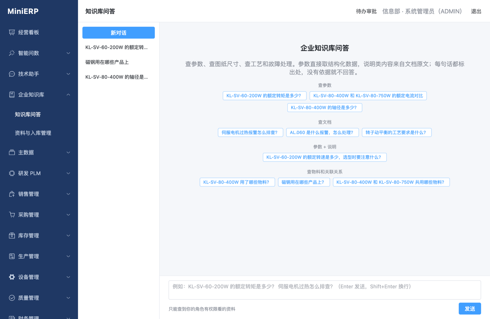

### 1. 查参数

问某个型号的参数，例如「KL-SV-60-200W 的额定转矩是多少？」。

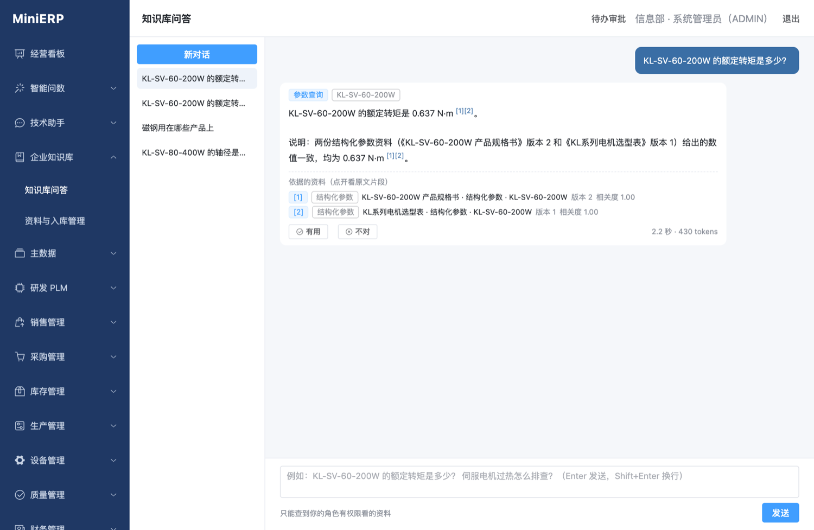

怎么看这个回答：

- 左上角的蓝色标签「参数查询」表示这个问题是直接查数据库得到的，数值是准确的，不是模型猜的。
- 句子后面的 `[1]` `[2]` 是出处编号，对应下面「依据的资料」里的同一编号。
- 同一个参数在规格书和选型表里都有时，两份都会列出来，方便你核对是否一致。

型号的写法不用很严格，`kl sv 60 200w`、`KL_SV_60_200W` 都能认出来。「额定扭矩」「转矩」这类不同叫法也会统一处理。

还可以这样问：

- 「KL-SV-80-400W 和 KL-SV-80-750W 的额定电流对比」
- 「额定转矩最大的伺服电机是哪款」
- 「额定功率大于 400W 的型号有哪些」

### 2. 追问

接着上一个问题问「它的额定转速呢」，不用重复型号。

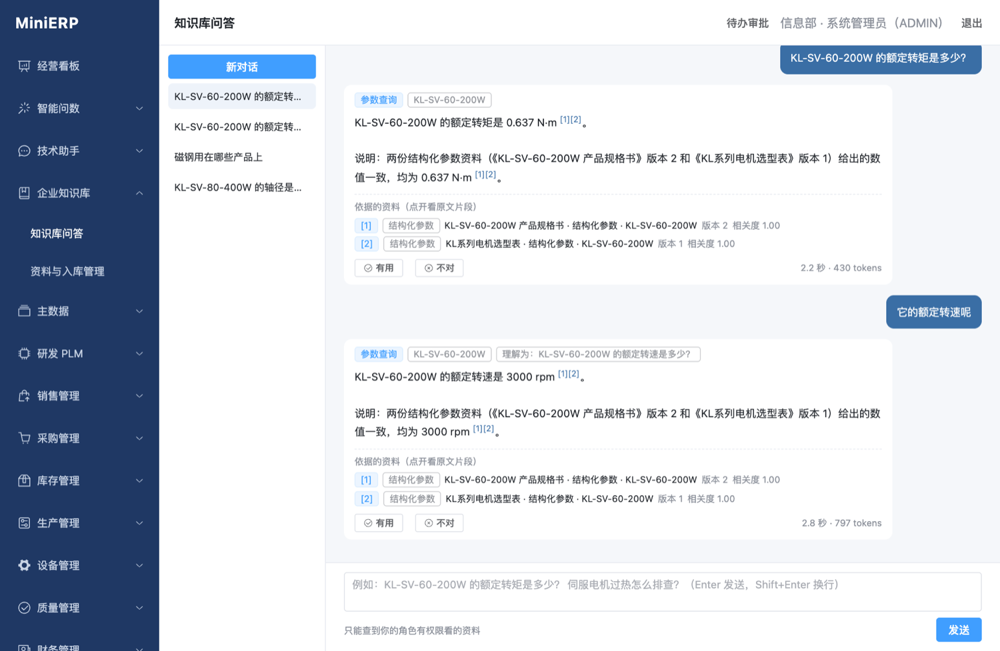

回答上方的灰色标签「理解为：……」显示系统把你的追问补全成了什么。如果补错了，直接把问题说完整再问一次。

聊的轮数多了也没关系：最近三轮原样保留，更早的会自动压缩成一段摘要，之前提过的型号不会丢。

### 3. 查做法、原因、故障处理

例如「伺服电机过热报警怎么排查？」。

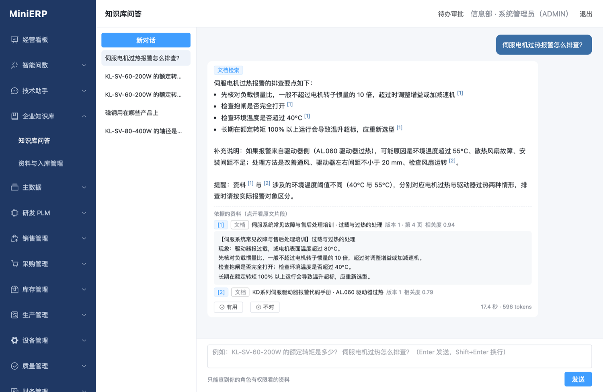

- 标签「文档检索」表示答案来自文档原文。
- 点「依据的资料」里的任意一行，可以展开看到被引用的原文片段，用来核对回答有没有走样。
- 每一行后面有版本号、页码（有页码的文档）和相关度。相关度越接近 1，说明这段资料和问题越对得上。

### 4. 参数和说明一起问

例如「KL-SV-80-400W 的轴径是多少，装配时要注意什么？」。

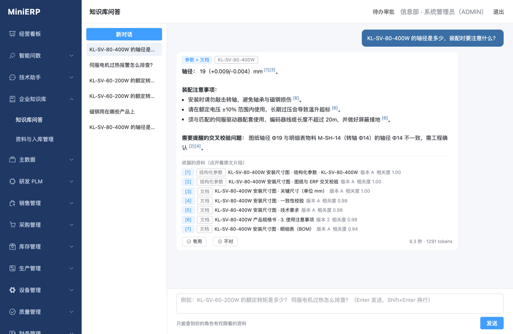

- 标签「参数 + 文档」表示两条路都走了：轴径和公差从图纸的结构化数据里取，装配注意事项从规格书里取。
- 这张图纸入库时系统发现「图纸轴径 Φ19 和 BOM 里的转轴 Φ14 对不上」，所以回答里会主动提醒。这是图纸和金蝶 EAS 数据自动交叉校验的结果。

### 5. 查物料清单

例如「KL-SV-80-400W 用了哪些物料？」，数据来自金蝶 EAS 同步过来的 BOM。

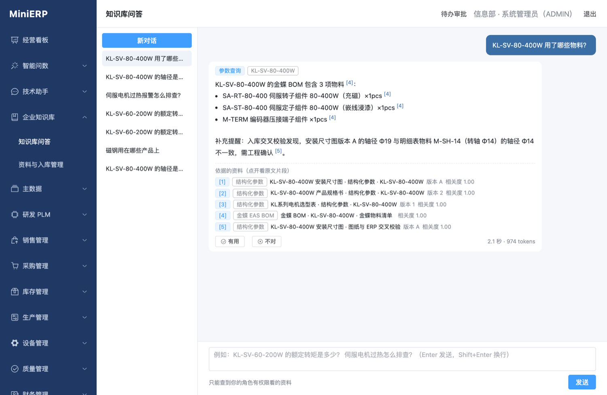

### 6. 查关联关系

需要跨好几层关系才能回答的问题，由知识图谱来查：

- 「磁钢用在哪些产品上？」
- 「KL-SV-80-400W 和 KL-SV-80-750W 共用哪些物料？」
- 「KL-SV-60-200W 同系列还有哪些型号？」

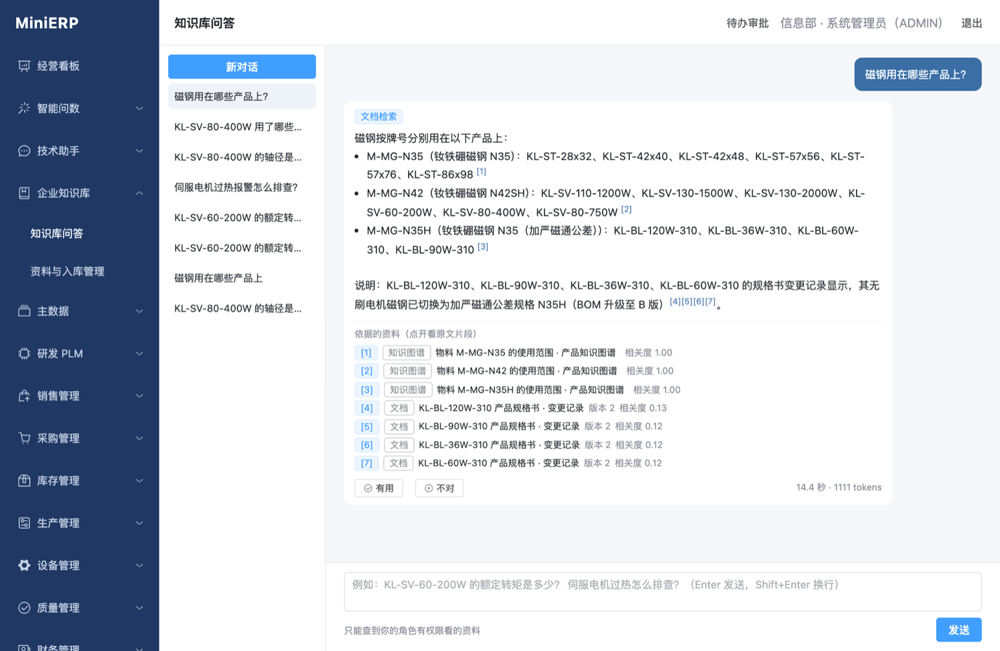

资料来源里标着「知识图谱」的就是图谱查出来的结果。

### 7. 觉得回答不对

点回答下面的「不对」，选一下问题类型；知道正确答案的话顺手填上。

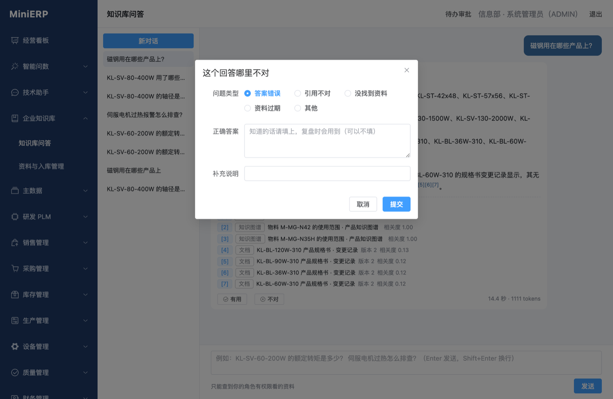

提交后这条记录会进入「Bad Case 池」，连同当时引用了哪些资料一起保存，方便之后复盘改进。觉得回答好就点「有用」。

### 8. 系统不回答的三种情况

系统宁可不答，也不会编一个答案。

**知识库里没有相关资料**（例如问天气）：

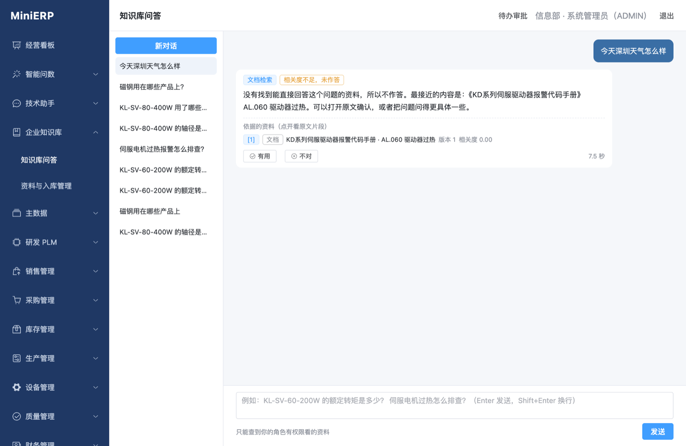

**有资料但你没有权限看**（例如用销售账号问来料检验标准）：

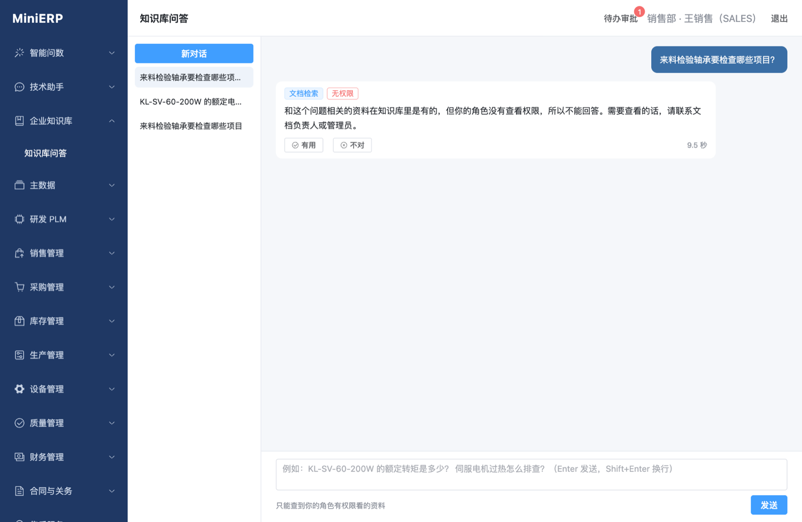

**问题涉及敏感内容**（例如问某个人的身份证号、工资）：会直接拦截并说明原因。

---

## 三、管理资料

进入「企业知识库 → 资料与入库管理」。只有管理员、研发、质量角色能看到这个页面。

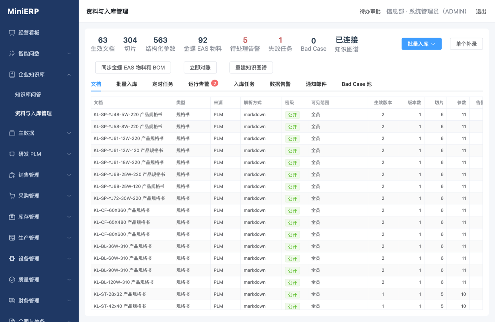

页面顶部是整体情况：有多少份生效的文档、多少个切片、多少条结构化参数、从金蝶 EAS 同步了多少物料、有几条告警待处理。

顶部的几个按钮：

| 按钮 | 作用 |
| --- | --- |
| 批量入库 | 一次入一批文件，有三种来源，见下面第 2 节 |
| 单个补录 | 临时补一份文档或一个新版本 |
| 同步金蝶 EAS 物料和 BOM | 重新从 EAS 拉一遍物料和 BOM |
| 立即对账 | 检查数据库和向量库的内容是否一致，不一致的自动修复（仅管理员） |
| 重建知识图谱 | 用最新的物料、BOM、文档关系重新生成图谱 |

### 1. 看一份文档的详情

点表格里的任意一行，右侧会滑出详情。

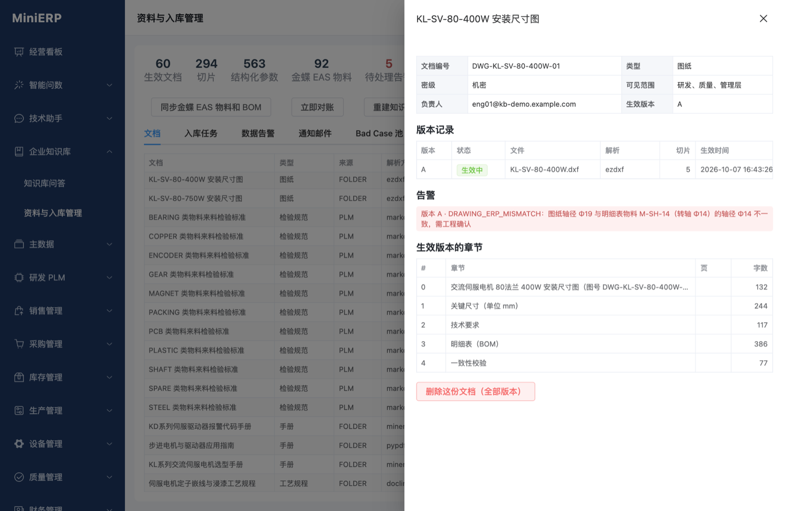

能看到：

- 密级、哪些角色能查到、负责人是谁
- 版本记录：每个版本的状态（生效中 / 已被替换 / 失败）
- 这份文档的告警（比如图纸和 BOM 对不上）
- 生效版本被切成了哪些章节

如果一份文档有旧版本，这里会出现「回滚到上一个版本」按钮，点了之后问答立刻改用旧版本的内容。

### 2. 批量入库

日常入库用批量的方式。点「批量入库」，有三种来源：

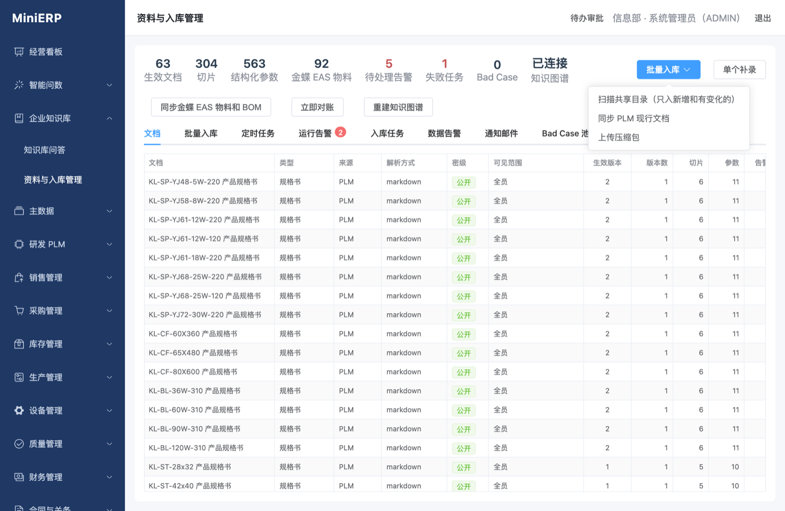

| 来源 | 怎么用 |
| --- | --- |
| 扫描共享目录 | 把文件放到共享目录（默认是 `assistant/data/kbase_inbox`）里对应的文件夹，点一下就会把**新增和有变化的**文件排成一批。每天凌晨 2:30 也会自动扫一次 |
| 同步 PLM 现行文档 | 把 PLM 里的现行版本拉过来，同样只入有变化的 |
| 上传压缩包 | 把一批文件按同样的目录约定打成 zip 上传 |

共享目录的约定：

```
kbase_inbox/
├── SOP/                                   ← 文件夹名是文档类型，决定默认的密级和可见范围
│   └── WI-PK-001__v1__成品包装与出货作业指导书.md     ← 文件名：编号__v版本__标题
├── INSPECTION/
│   └── QC-FQC-002__v1__伺服电机出厂检验规范.md
└── MANUAL/
    └── MAN-SV-INSTALL__v1__伺服电机安装与接线手册.md
```

文档类型可以用：`DATASHEET` 规格书、`MANUAL` 手册、`SOP` 作业指导书、`INSPECTION` 检验规范、`DRAWING` 图纸、`TRAINING` 培训资料、`PROCESS` 工艺规程、`SELECTION` 选型表。
需要逐个指定密级和可见范围时，在目录根下放一份 `manifest.csv`，列为 `file, doc_key, version, title, doc_type, security_level, acl_groups, owner_email, product_code`。

每一批的进度在「批量入库」页签里看：

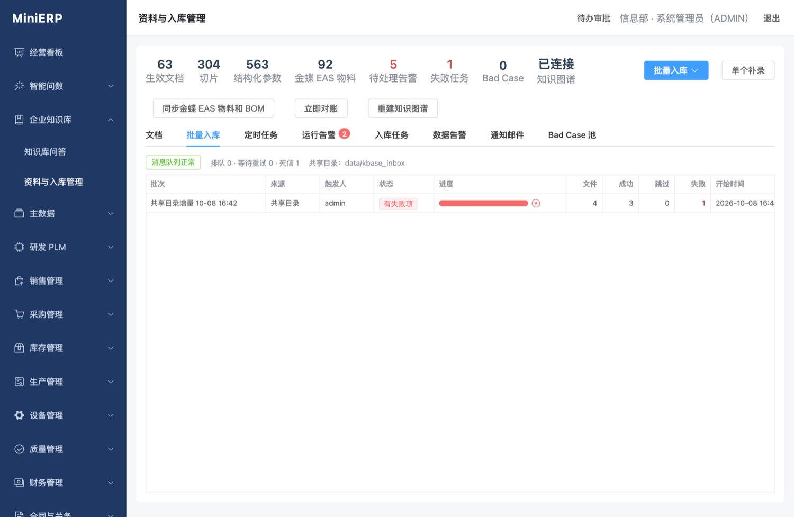

- 上方一行是消息队列的状态：排队多少、等待重试多少、死信（重试用完仍失败）多少。
- 单个文件失败不影响整批。临时故障会自动重试 3 次；文件本身有问题（加密、损坏、类型不支持）不重试，直接跳过。
- **一批里失败比例超过 20% 会自动暂停整批**并告警，确认原因后点「继续」或「取消」。
- 一批结束只发一封汇总通知，逐条列出失败的文件和原因。
- 有失败的批次可以点「重试失败项」。

点任意一批可以看每个文件的结果和失败原因：

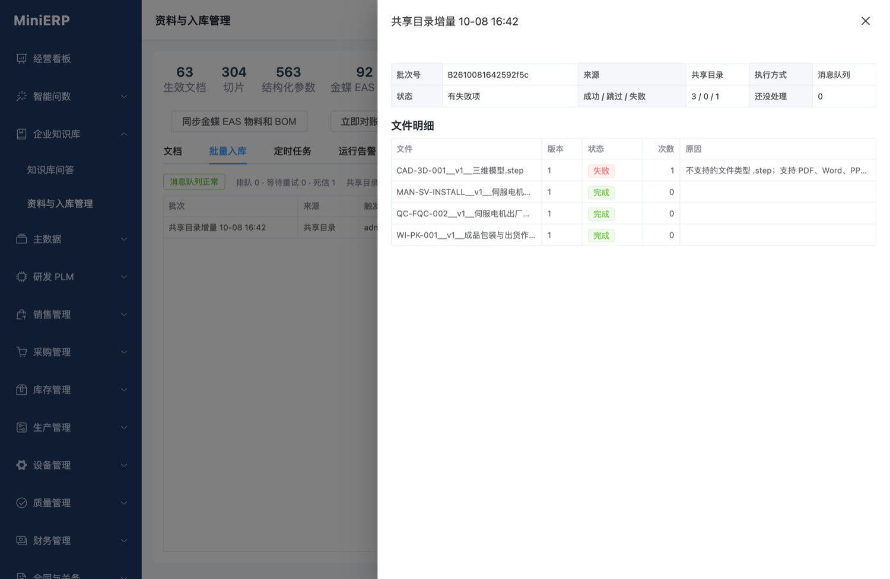

样例目录里特意放了一个不支持的文件（`.step`）和一个没按约定命名的文件，用来演示失败和被忽略的情况。

### 2.1 单个补录

点「单个补录」可以只上传一份文档。

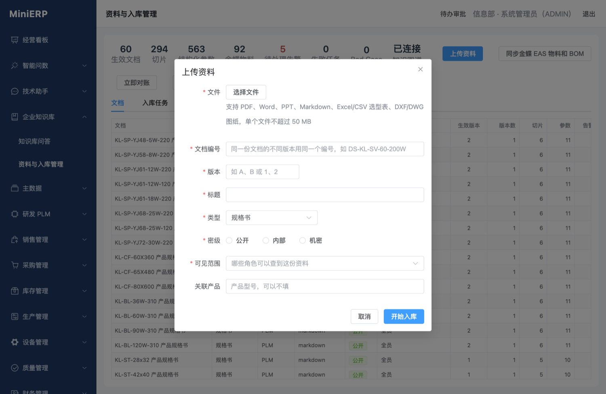

填写时注意：

- **文档编号**：同一份文档的不同版本要用同一个编号，系统靠它判断这是新文档还是新版本。
- **版本**：内容改了就必须升版本号。版本号没变但内容变了，系统会拒绝。
- **密级和可见范围**：必须选，不选不能入库。
- 支持 PDF、Word、PPT、Markdown、Excel 选型表、DXF 图纸。

几种会被直接拒绝的情况：加密的 PDF、损坏的文件、空文件、不支持的类型、比当前版本还旧的版本。

### 3. 看单个文件的入库进度

单个补录后自动跳到「入库任务」页签，每 3 秒刷新一次；批量入库的每个文件也会出现在这里。

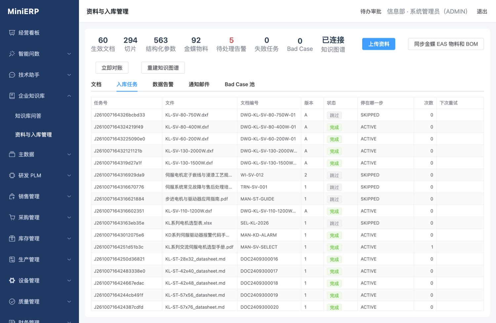

| 状态 | 意思 |
| --- | --- |
| 完成 | 已经可以在问答里查到 |
| 跳过 | 这个版本之前已经入库，内容没变 |
| 等待重试 | 遇到临时故障（比如网络断了），系统会自动重试 3 次，不用管 |
| 失败 | 「原因」一列写了为什么；修正后点「重试」，或者重新上传 |

入库失败时，线上仍然是这份文档之前的版本，不会出现只导了一半的情况。

### 4. 数据告警

图纸和金蝶 EAS 的数据对不上时会在这里出现。

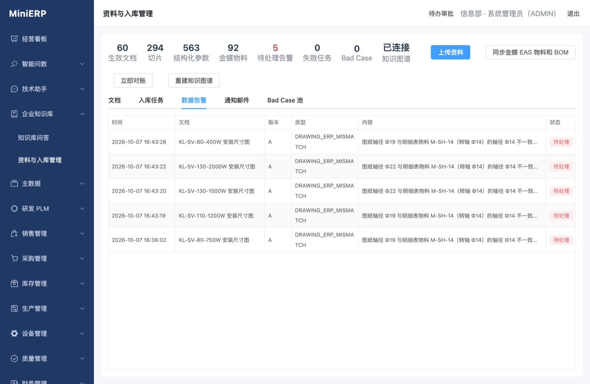

### 5. 通知邮件

入库失败、发现数据不一致时，系统会给文档负责人写一封邮件。点每行左边的箭头可以看正文。

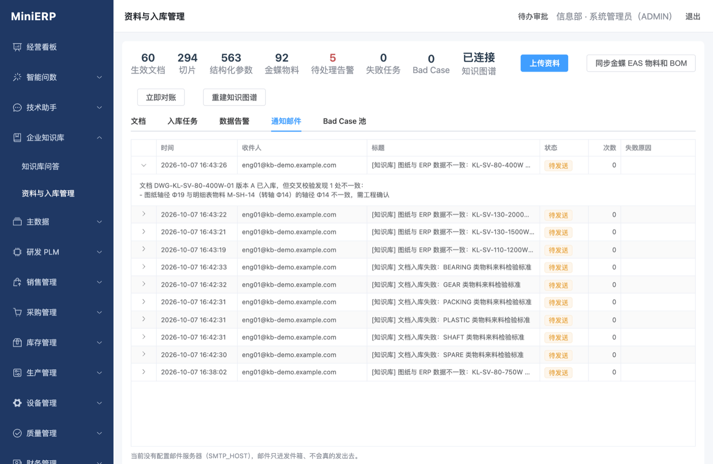

现在没有配置邮件服务器，所以邮件都停在「待发送」。在 `assistant/.env` 里填上 `SMTP_HOST` 等配置后会自动发出。邮件里只写文档名称和失败原因，不带文档正文。

### 6. Bad Case 池

所有被点了「不对」的回答都在这里，点开可以看到当时的回答、用户填的正确答案、引用了哪些文档版本和切片。

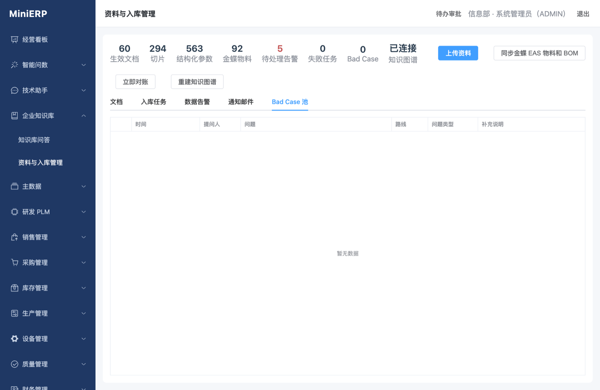

### 7. 定时任务

「定时任务」页签列出系统自己会定时做的事，能看到上次什么时候跑的、结果如何、下次什么时候跑。

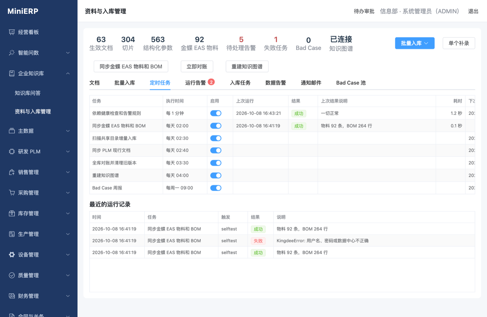

- 每个任务都可以点「立即执行」手动跑一次。
- 管理员可以用开关停用某个任务。
- 任务失败会进「运行告警」，下次成功后告警自动关闭。

### 8. 运行告警

「运行告警」页签上半部分是各个依赖和熔断器的当前状态，下半部分是告警列表。

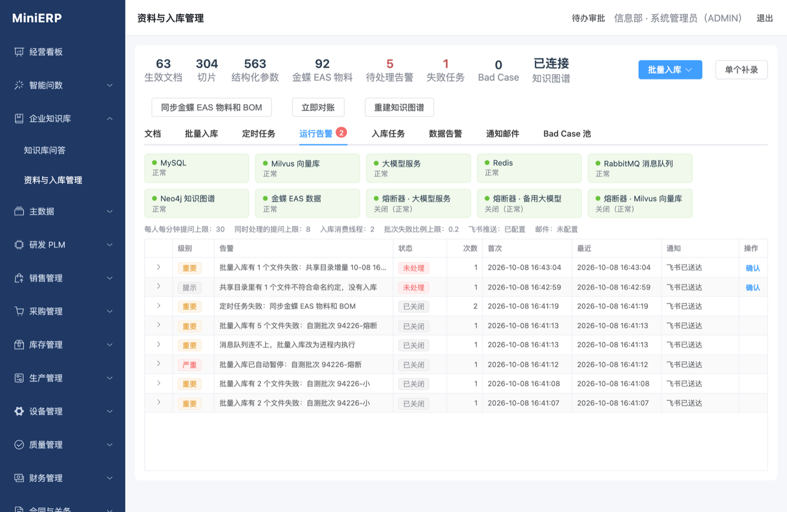

- 绿色表示正常；变红时卡片上会写明当前降级成了什么（例如「问答已降级为只用结构化参数和全文检索」）。
- 告警分三级：严重、重要、提示。同一个问题只出现一条，重复发生只累加次数。
- 问题消失后告警会自动关闭；也可以手动「确认」（表示有人在处理了）或「关闭」。
- 告警同时推送到飞书和邮件。现在飞书指向的是本地模拟接收端，收到的消息在 <http://localhost:8096/feishu/messages> 能看到。换成真实的飞书机器人，改 `assistant/.env` 里的 `FEISHU_WEBHOOK` 和 `FEISHU_SECRET` 后重启。

---

## 四、智能问数

左侧菜单「智能问数 → 经营与人力问数」。用一句话查制度、查数据、问原因，用法和知识库问答一样，直接输入或点示例。

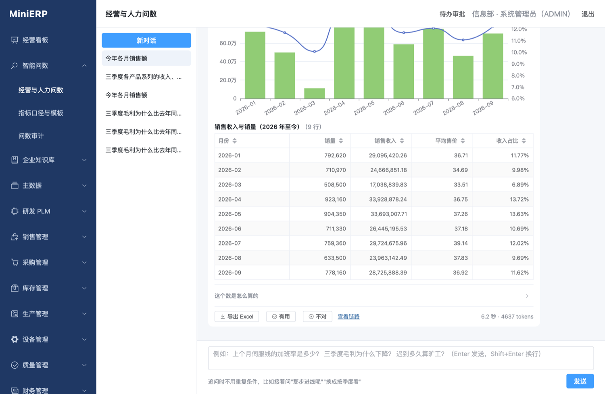

问数的详细说明见 `Copilot-04-实现说明与评测结果.md`。问数和知识库共用同一套限流、熔断、降级和监控。

---

## 五、系统出问题时你会看到什么

系统的某个部分出故障时，问答不会直接报错，而是换一种方式尽量回答，并在回答上方用黄色条标出来。

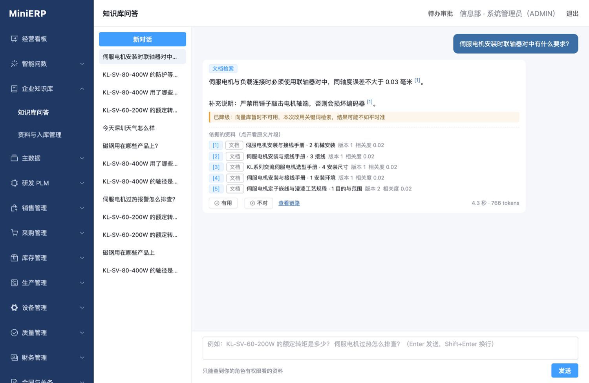

上面这张图是手动停掉向量库之后提的问：系统自动改用关键词检索，照样给出了带出处的回答。

| 黄色条上写的 | 意思 |
| --- | --- |
| 向量库暂时不可用，本次改用关键词检索 | 能答，但找资料的准确度不如平时 |
| 当前提问的人多，本次没有做精排 | 能答，但资料排序没有经过二次筛选 |
| 大模型暂时不可用，下面是检索到的原文摘录 | 不整理成回答了，直接给你原文 |
| 大模型暂时不可用，这次只给数据，没有文字解读（问数） | 表格照常，少了那段文字说明 |
| 主模型不可用，这次回答由备用模型生成 | 能答，质量可能略低 |

另外两种提示：

- 「提问太频繁了，请稍后再试」：同一个人一分钟内问得太多（默认上限 30 次）。
- 「当前提问的人比较多，请过几秒再试」：同时提问的人数超过了上限，过几秒再问即可。

---

## 六、监控和排查（给管理员）

| 页面 | 地址 | 看什么 |
| --- | --- | --- |
| 监控看板（Grafana） | <http://localhost:3003> | 请求量、响应时间、降级和拒绝次数、熔断器、队列，整体是否健康 |
| 链路追踪（Langfuse） | <http://localhost:3002> | 某一次问答每一步做了什么，排查「这个回答为什么不对」 |
| 消息队列（RabbitMQ） | <http://localhost:15673> | 队列里积压了多少、处理速度 |

登录账号都是本地演示用的，写在 `assistant/docker-compose.yml` 里。

监控看板：

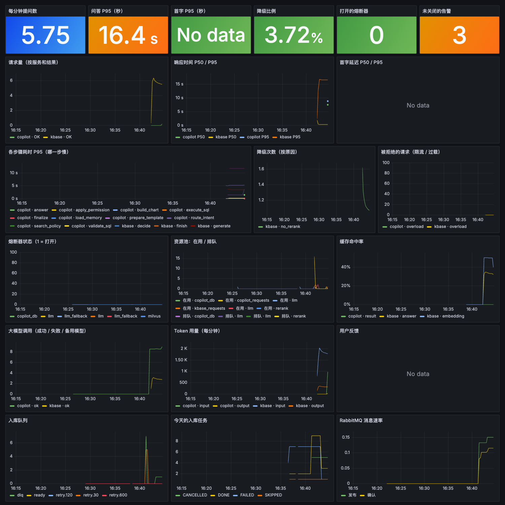

链路追踪需要另外启动（比较占内存，用的时候再开）：

```bash
cd ~/Desktop/Python/Projectbydate/MiniERP/assistant && docker compose --profile langfuse up -d
```

启动后，用管理员账号提问时，回答下方会多一个「查看链路」；Bad Case 池里每条记录也有链路地址。点进去能看到这次问答的每一步：

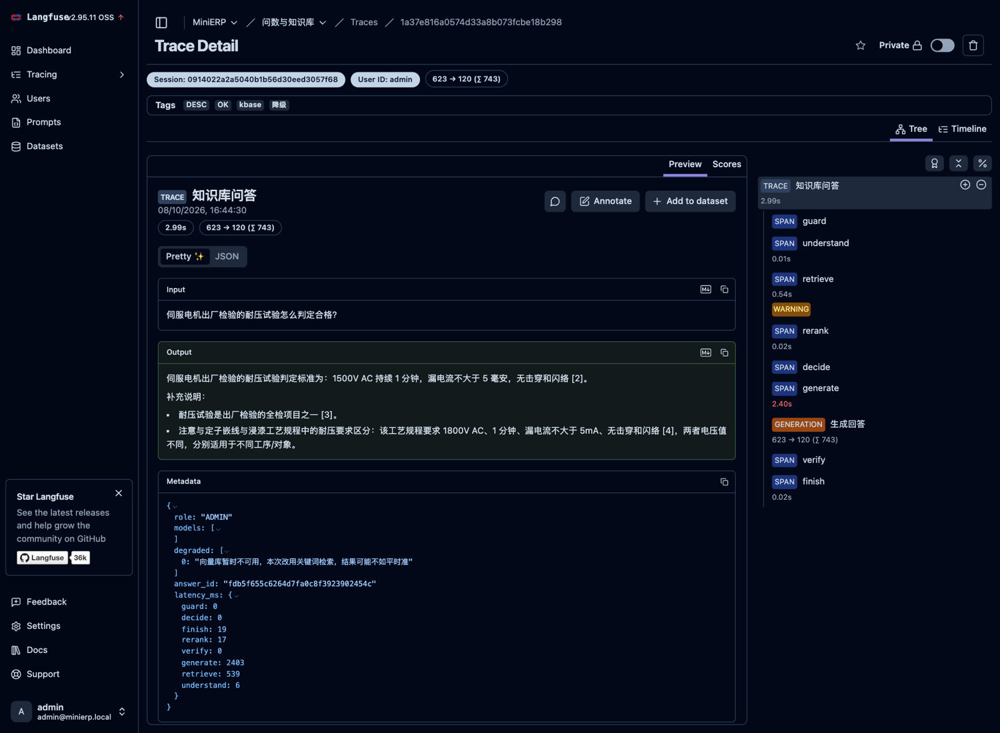

右边是步骤：输入检查、理解问题、检索、重排、判断、生成、校验、收尾，每一步的耗时都在。图里检索那一步标了黄色的警告，就是上一节那次向量库故障。

---

## 七、常见问题

**页面提示「知识库服务没有启动」**
执行 `./scripts/kbase.sh status` 看一下；没在运行就 `./scripts/kbase.sh start`。

**回答很慢**
问参数一般几秒。问文档类的问题要经过检索、重排、生成三步，本机没有独立显卡，通常要 10 到 20 秒。

**知识图谱显示「未启动」**
执行 `cd assistant && docker compose up -d neo4j`，然后在管理页面点「重建知识图谱」。

**上传 PDF 一直在「等待重试」**
带表格或扫描的 PDF 要调用 MinerU 的云端接口，需要能访问外网。网络恢复后会自动重试成功。

**DWG 图纸上传被拒绝**
DWG 需要先转成 DXF，本机没有安装转换工具（ODA File Converter）。可以先在 CAD 软件里另存为 DXF 再上传。

**想重新导入全部样例资料**

```bash
cd ~/Desktop/Python/Projectbydate/MiniERP/assistant && PYTHONPATH=. .venv/bin/python -m app.kbase.ingest.batch all
```

内容没变的文档会自动跳过，不会重复。
