<!-- 由 assistant/scripts/make_rag_slides.py 生成；代码片段按函数名从当前代码里截取，改了代码重新运行即可更新。流程图用 Mermaid 语法（Typora、VS Code、GitHub 都能直接显示）。每页之间用 --- 分隔，可以直接导入 Marp / Slidev 当幻灯片放。 -->

# 企业知识库问答 Agent（多模态 RAG）

**讲解提纲**

1. 这个系统解决什么问题，整体长什么样
2. 文档怎么进来：入库流水线、增量更新
3. 数据放在哪：分层存储、图文关联
4. 参数和图纸怎么变成能查的数据
5. 一个问题从提问到回答经过了什么
6. 谁能看什么：权限与安全
7. 出错了怎么办：稳定性与一致性
8. 怎么知道效果好不好：可观测与评测
9. 部署、成果、现场演示

> 每一页：先用大白话讲「是什么、为什么」，再给流程图，最后是真实代码（带文件和行号，点开就能看）。

---

## 1. 一句话说清楚

**问题**：产品参数、技术资料、CAD 图纸散在手册、规格书、选型表和图纸里，大量参数藏在图片和扫描页里。研发、销售、售后查一个参数要翻半天，还容易翻到旧版本。

**做法**：把这些资料统一导进知识库，员工用一句话提问：

| 问法 | 系统怎么答 |
|---|---|
| 「KL-SV-80-750W 的额定转矩是多少？」 | 直接查数据库里的参数表，数值精确，不靠大模型「猜」 |
| 「伺服电机发烫是什么原因？」 | 从文档里找相关段落，让大模型组织成回答 |
| 两者都有 | 两条路一起走 |

**三条底线**：每句话标出处（文档号、章节、页码，带原图）；资料里没有就说没有；没权限的资料查不到。

**分三期上线**：规章制度和培训资料 → 产品参数和选型资料（引入 SQL 精确查询）→ CAD 图纸和 BOM（多模态解析）。

---

## 2. 整体架构

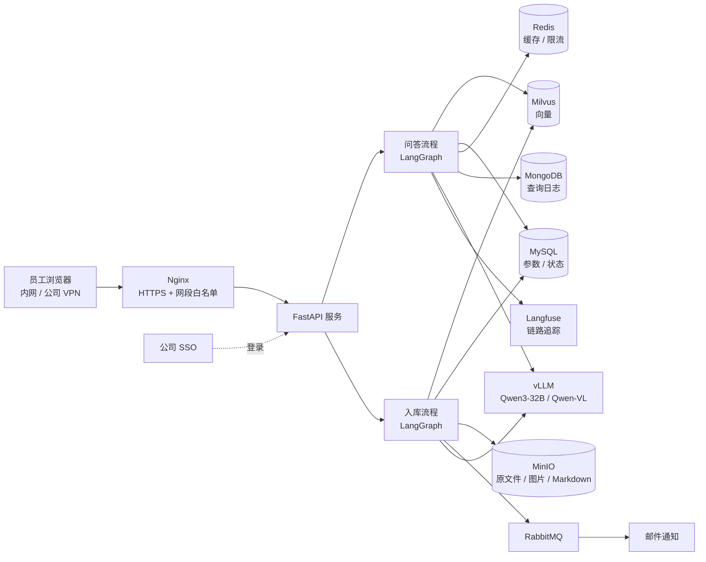

**两条主线**：左边是「问」（问答流程），右边是「存」（入库流程）。两条线都用 LangGraph 编排成一张流程图，每一步是一个节点，出错有统一的处理出口。

**一条原则**：MySQL 是「真相」，Milvus 是从 MySQL 派生出来的检索索引。两边对不上时，以 MySQL 为准，Milvus 可以随时按 MySQL 重建。

---

## 3. 每个组件干什么（大白话版）

| 组件 | 在这个项目里干什么 | 打个比方 |
|---|---|---|
| LangGraph | 把入库和问答编排成流程图：先做什么、后做什么、出错去哪 | 流水线的传送带 |
| Qwen3-32B（vLLM 本地部署） | 识别 chunk 讲的是哪个型号、改写问题、写假设答案、生成回答 | 读得懂资料的助理 |
| Qwen-VL | 看图：扫描页转文字、给插图写说明、复核看不全的图纸 | 会看图的助理 |
| MinerU / Docling | PDF、Word、PPT 转成 Markdown（保留标题、表格、图片位置） | 扫描仪 + 排版 |
| ezdxf + ODA | 读 CAD 图纸里的线、字、标注 | 会看图纸的绘图员 |
| BGE-M3 | 把一段文字变成一串数字（向量），意思相近的文字数字也相近 | 给每段话打「语义坐标」 |
| BM25 | 按关键词字面匹配（型号、报警代码这种必须一字不差的） | 传统搜索引擎 |
| bge-reranker-v2-m3 | 把召回的几十条资料逐条和问题对比打分，挑最相关的 | 复审员 |
| Milvus | 存向量，按「意思相近」和「关键词」查 | 图书馆的索引卡 |
| MySQL | 存参数表、切片状态、版本、权限标注 | 账本 |
| MinIO | 存原文件、图片、解析后的 Markdown（私有，不能直接访问） | 档案室 |
| MongoDB | 存每一次问答的完整过程（问题、改写、召回、答案、反馈） | 行车记录仪 |
| Redis | 缓存、限流、登录状态、权限缓存 | 前台的便签 |
| RabbitMQ | 导入结果通知的消息队列 | 收发室 |
| Langfuse | 每次问答每一步的耗时、输入输出、token | 体检报告 |

---

## 4. 文档入库：整条流水线

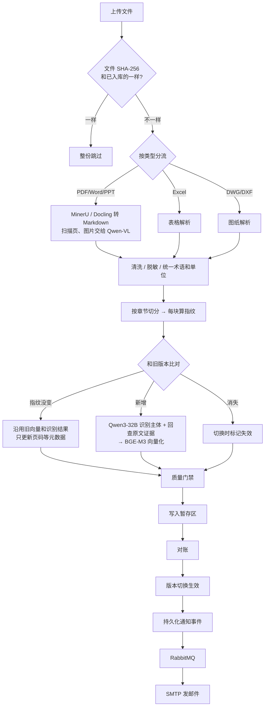

**为什么用流程图编排**：每个节点只干一件事；任何节点出错都不往外抛，统一走「失败出口」——能重试的（网络抖动、模型超时）按 30 秒 / 2 分钟 / 10 分钟退避重试，不能重试的（加密、损坏、缺密级）直接通知负责人。重试时已经做完的步骤（解析、向量化）从磁盘读结果，不重做。

---

## 4.1 统一的错误处理：每个节点都套一层

大白话：每个步骤外面包了一层「保险」。步骤里出了错，保险把错误分成两类写进状态，流程自动转到失败出口，不会整个崩掉。

📄 [app/kbase/ingest/graph.py:88](../assistant/app/kbase/ingest/graph.py#L88)

```python
def _safe(fn):
    """节点装饰器：记录阶段；异常不外抛，分类后写进 state['error']"""
    name = fn.__name__

    def wrapper(state: IngestState) -> dict:
        store.execute("UPDATE kb_ingest_job SET stage = %s WHERE job_id = %s", (name, state["job_id"]))
        start = time.time()
        try:
            out = fn(state) or {}
            logger.info(f"[kbase] {state['job_id']} {STAGE_CN.get(name, name)} {int((time.time() - start) * 1000)}ms")
            return out
        except Rejected as e:
            return {"error": {"stage": name, "message": str(e), "retryable": False}}
        except Exception as e:
            logger.exception(f"[kbase] {state['job_id']} {STAGE_CN.get(name, name)}失败")
            return {"error": {"stage": name, "message": f"{type(e).__name__}: {str(e)[:300]}", "retryable": True}}
    wrapper.__name__ = name
    return wrapper
```

**注解**
- `Rejected`：文件本身有问题（加密、损坏、类型不支持），重试没用 → `retryable=False`
- 其他异常：多半是临时问题（网络、模型超时）→ `retryable=True`，失败出口会排期重试
- 每进一个节点就把任务表的 `stage` 更新一下，页面上能看到任务卡在哪一步

---

## 4.2 第一层指纹：整份文件没变就跳过

大白话：文件先算一个 SHA-256（相当于文件的「身份证号」，内容差一个字节结果就完全不同）。和数据库里这个版本的记录比：

📄 [app/kbase/ingest/versioning.py:54](../assistant/app/kbase/ingest/versioning.py#L54)

```python
def decide(doc_key: str, version: str, sha: str) -> tuple[str, str]:
    """
    文件级判重。返回（动作, 说明）：
      SKIP      内容和已入库的这个版本完全一样，跳过
      CONFLICT  版本号没变但内容变了，拒绝（版本号没升就改了内容，是流程问题）
      STALE     版本号比当前生效的还旧，拒绝
      NEW       新文档或新版本
      RESUME    同一版本上次没导完，接着做
    """
    doc = store.one("SELECT active_version FROM kb_document WHERE doc_key = %s", (doc_key,))
    ver = store.one("SELECT status, file_sha256 FROM kb_doc_version WHERE doc_key = %s AND version = %s", (doc_key, version))
    if ver:
        if ver["status"] in ("ACTIVE", "SUPERSEDED", "PURGED"):
            if ver["file_sha256"] == sha:
                return "SKIP", f"版本 {version} 已经入库，内容没有变化"
            return "CONFLICT", f"版本 {version} 已经入库，但这次的文件内容不同；内容有修改时必须升版本号"
        return "RESUME", f"版本 {version} 上次没有导完，继续"
    if doc and doc["active_version"] and _older(version, doc["active_version"]):
        return "STALE", f"版本 {version} 比当前生效的版本 {doc['active_version']} 还旧"
    return "NEW", "新版本" if doc else "新文档"
```

**五种结果**：同版本同内容 → 跳过；版本号没升但内容变了 → 拒绝（这是流程问题，必须升版本号）；比当前版本还旧 → 拒绝；新文档或新版本 → 正常导入；上次没导完 → 接着做。

---

## 4.3 按文件类型路由解析

| 文件 | 用什么 | 为什么 |
|---|---|---|
| 纯文字 PDF | pypdf 直接抽文字 | 快，保留页码 |
| 带表格、插图的 PDF | MinerU | 版面还原最好，表格变成 Markdown 表格，图片导出成文件 |
| 扫描件（每页字很少） | 逐页渲染成图片 → Qwen-VL 转写 | 扫描件没有文字层 |
| Word | Docling（失败退 python-docx） | 图片按原位置导出 |
| PPT | python-pptx 按页读 | 要保留「第几页」 |
| 图片文件 | Qwen-VL 转写 + 写说明 | 现场照片、铭牌、截图 |
| Excel 选型表 | 表格解析 | 每行一个型号，每列一个参数 |
| DWG / DXF | ODA 转换 + ezdxf | 读矢量实体，后面专门讲 |

📄 [app/kbase/ingest/parsers.py:151](../assistant/app/kbase/ingest/parsers.py#L151)

```python
def parse_doc(path: Path, kind: str, work_dir: Path, doc_key: str = "", title: str = "") -> dict:
    """返回 {markdown, parsed_by, images}。images 是这份文档里每张图的登记信息（对象路径、哈希、摘要）"""
    from app.kbase.ingest import images
    img_dir, found = Path(work_dir) / "images", []
    if kind == "md":
        md = path.read_text(encoding="utf-8", errors="replace")
        return {"markdown": images.enrich(md, path.parent, doc_key, sink=found), "parsed_by": "markdown", "images": found}
    if kind == "image":                                                         # 图片文件：视觉模型转写
        md = images.image_file_to_markdown(path, title or path.stem)
        return {"markdown": images.enrich(md, path.parent, doc_key, sink=found), "parsed_by": "qwen-vl" if images.vl_available() else "image",
                "images": found}
    if kind == "docx":
        md = _docling(path, img_dir)
        return {"markdown": images.enrich(md or _docx(path, img_dir), Path(work_dir), doc_key, sink=found),
                "parsed_by": "docling" if md else "python-docx", "images": found}
    if kind == "pptx":                                                          # 要保留"第几页"，自己按页读
        return {"markdown": images.enrich(_pptx(path, img_dir), Path(work_dir), doc_key, sink=found), "parsed_by": "python-pptx", "images": found}
    text, per_page = _pdf_text(path)
    reason = _pdf_needs_mineru(path, text, per_page)
    if reason is None:                                                          # 纯文字 PDF：本地解析，保留页码
        return {"markdown": _headings(text), "parsed_by": "pypdf", "images": []}
    if reason.startswith("每页只有") and images.vl_available():                # 扫描件：逐页渲染交给视觉模型转写
        logger.info(f"[kbase] {path.name} 逐页交给视觉模型：{reason}")
        return {"markdown": images.scanned_pdf_to_markdown(path, Path(work_dir)), "parsed_by": "qwen-vl", "images": []}
    logger.info(f"[kbase] {path.name} 交给 MinerU：{reason}")
    from app.kbase.ingest import mineru as pdf_parse_service                    # 带表格或带图片：MinerU 还原版面、表格并导出图片
    md_file = Path(pdf_parse_service.pdf_to_markdown(str(path), str(work_dir)))
    return {"markdown": images.enrich(md_file.read_text(encoding="utf-8"), md_file.parent, doc_key, sink=found), "parsed_by": "mineru", "images": found}
```

**注解**：不管走哪条路，最后都变成 Markdown（带 `<!-- page:N -->` 页码标记），文档里的图片统一交给 `images.enrich`：存进 MinIO 私有桶，并让视觉模型写一段说明放在图下面，这样图里的参数也能被搜到。

---

## 4.4 清洗：脱敏 + 统一术语和单位

大白话：
- **脱敏**：资料里偶尔有手机号、邮箱、身份证号，入库前打码，向量库和大模型都看不到原文。
- **统一说法**：同一个东西有好几种写法（扭矩 / 转矩、Nm / N·m、°C / ℃、φ / Φ），统一成一种，不然用户搜「转矩」搜不到写着「扭矩」的段落。

📄 [app/kbase/ingest/clean.py:126](../assistant/app/kbase/ingest/clean.py#L126)

```python
def mask_sensitive(md: str) -> tuple[str, dict]:
    """返回（打码后的文本, 各类命中次数）。图片链接里的路径不动"""
    stats: dict[str, int] = {}
    keep = {}

    def hide(m: re.Match) -> str:                          # 图片和链接的地址先藏起来，打码完再放回去
        keep[f"\x00{len(keep)}\x00"] = m.group(0)
        return f"\x00{len(keep) - 1}\x00"
    text = re.sub(r"\]\([^)]*\)", hide, md)
    for pattern, repl, kind in _MASK:
        text, n = pattern.subn(repl, text)
        if n:
            stats[kind] = n
    from app.kbase.query.guard import _words              # 和问答输出共用一张敏感词表
    for w in _words()["脱敏"]:
        text, n = re.subn(re.escape(w), "＊" * len(w), text, flags=re.I)
        if n:
            stats["敏感词"] = stats.get("敏感词", 0) + n
    for k, v in keep.items():
        text = text.replace(k, v)
    return text, stats
```

📄 [app/kbase/ingest/clean.py:168](../assistant/app/kbase/ingest/clean.py#L168)

```python
def unify_terms(md: str) -> tuple[str, int]:
    n = 0
    md = re.sub(r"[φø⌀∅]", lambda m: "Φ", md)
    for pattern, dst in _terms():
        md, k = pattern.subn(dst, md)
        n += k
    return md, n
```

**效果**（单元测试里的真实例子）：

| 原文 | 处理后 |
|---|---|
| 联系 13812345678，邮箱 zhang.san@kelang-motor.example.com | 联系 138\*\*\*\*5678，邮箱 z\*\*\*@kelang-motor.example.com |
| 额定扭矩 1.27 Nm，温度 40 °C，轴径 φ14，Nmax | 额定转矩 1.27 N·m，温度 40 ℃，轴径 Φ14，Nmax（不是单位，不动） |

单位只在数字后面替换，所以 `Nmax` 里的 `Nm` 不会被误改。术语表是一个文本文件（`resources/terms.txt`），研发和质量可以自己维护。

---

## 4.5 主体识别：大模型识别 + 原文证据校验

**为什么要识别主体**：31 份规格书结构几乎一样，不标清楚每块讲的是哪个型号，检索时很容易拿 400W 的段落回答 750W 的问题。

**为什么要校验**：大模型会「猜」。所以要求它摘一句原文当证据，再用代码核对：

📄 [app/kbase/ingest/subject.py:62](../assistant/app/kbase/ingest/subject.py#L62)

```python
def check(out: dict, text: str, meta: dict) -> tuple[dict | None, str]:
    """证据校验。通过返回（清洗后的结果, ""），不通过返回（None, 原因）"""
    ev = (out.get("evidence") or "").strip()
    if len(_squash(ev)) < 6 or _squash(ev) not in _squash(text):
        return None, "证据片段在原文里找不到"
    models = []
    for m in out.get("models") or []:
        m = normalize_model(str(m).strip())
        if not MODEL_RE.fullmatch(m):
            return None, f"型号 {m} 不符合编码规则"
        if m not in text and m != meta.get("product_code"):
            return None, f"型号 {m} 在原文和文档元数据里都没有"
        models.append(m)
    series = (out.get("series") or "").strip().upper()
    if series and series not in SERIES_CN:
        return None, f"系列 {series} 不在系列表里"
    expect = {series_of(m) for m in models} - {None}
    if series and expect and series not in expect:
        return None, f"系列 {series} 和型号前缀不一致"
    series = series or (expect.pop() if len(expect) == 1 else "")
    topic = out.get("topic") if out.get("topic") in TOPICS else "其他"
    return {"models": models, "series": series, "topic": topic, "evidence": ev[:120], "by": "llm"}, ""
```

**注解**
1. 证据必须能在原文里找到（忽略空格）——防止模型编一句话当证据
2. 型号必须出现在原文里，或者就是文档登记的型号——防止模型「联想」出别的型号
3. 系列必须和型号前缀一致（KL-SV 只能是伺服）
4. 任何一条不过：**模型的结果不入库**，退回规则识别（正则找型号 + 文档元数据），并记下原因

---

## 4.6 主体识别：逐块调用，失败过半自动改规则

📄 [app/kbase/ingest/subject.py:93](../assistant/app/kbase/ingest/subject.py#L93)

```python
def identify(chunks: list[dict], meta: dict, use_llm: bool | None = None) -> dict:
    """给 chunks（只传新增的）逐块识别主题，结果写回每个 chunk 的 subject / item_name / series。返回统计"""
    use_llm = settings.kbase_subject_llm if use_llm is None else use_llm
    stats = {"llm": 0, "rule": 0, "check_failed": 0, "call_failed": 0}
    lock, fails = threading.Lock(), {"n": 0, "done": 0}

    def one(c: dict) -> None:
        sub, why = None, ""
        tripped = fails["done"] >= 6 and fails["n"] / fails["done"] > 0.5
        if use_llm and not tripped:
            try:
                from app.platform import resilience as R
                sub, why = check(R.run_with_timeout("主题识别", TIMEOUT, _call, c["content"], meta), c["content"], meta)
                with lock:
                    fails["done"] += 1
                    stats["check_failed" if sub is None else "llm"] += 1
            except Exception as e:
                why = f"模型调用失败：{type(e).__name__}"
                with lock:
                    fails["done"] += 1
                    fails["n"] += 1
                    stats["call_failed"] += 1
        elif use_llm:
            why = "模型连续失败过半，改用规则"
        if sub is None:
            sub = {**rule_subject(c["content"], meta), "fallback_reason": why or "未启用模型识别"}
            with lock:
                stats["rule"] += 1
        c["subject"] = sub
        c["item_name"] = sub["models"][0] if len(sub["models"]) == 1 else (c.get("item_name") or "")
        c["series"] = sub["series"] or ""

    with ThreadPoolExecutor(WORKERS) as pool:
        list(pool.map(one, chunks))
    # ……（后面省略，完整代码见链接）
```

**注解**：只对**新增**的 chunk 调用（沿用的直接复用上一版结果）；4 个线程并发；前 6 次里失败超过一半，说明模型服务有问题，剩下的直接用规则，不再一块块等超时。

---

## 4.7 Metadata：每个 chunk 带什么标签

| 字段 | 含义 | 用在哪 |
|---|---|---|
| `doc_key`（doc_id） | 文档编号（来自 PLM 文档号 / 图号，不是文件名） | 对账、引用出处 |
| `version` | 版本 | 只查生效版本 |
| `page` / `section` | 页码、章节 | 回答里标出处 |
| `acl` / `level` | 可见范围（角色、部门）/ 数字密级 | 检索前权限过滤 |
| `item_name` / `series`（subject） | 型号 / 系列 | 主题锁定后按它过滤 |
| `state` | PENDING / VALID / INVALID | 只查生效的 chunk |

📄 [app/kbase/vectors.py:30](../assistant/app/kbase/vectors.py#L30)

```python
def schema():
    c = milvus_gateway.client
    s = c.create_schema(auto_id=False, enable_dynamic_field=False)
    s.add_field("chunk_id", DataType.VARCHAR, is_primary=True, max_length=32)
    s.add_field("doc_key", DataType.VARCHAR, max_length=80)
    s.add_field("version", DataType.VARCHAR, max_length=16)
    s.add_field("doc_type", DataType.VARCHAR, max_length=20)
    s.add_field("title", DataType.VARCHAR, max_length=400)
    s.add_field("section", DataType.VARCHAR, max_length=400)
    s.add_field("page", DataType.INT32)
    s.add_field("item_name", DataType.VARCHAR, max_length=200)
    s.add_field("series", DataType.VARCHAR, max_length=30)
    s.add_field("parent_id", DataType.VARCHAR, max_length=32)
    s.add_field("security_level", DataType.VARCHAR, max_length=12)
    s.add_field("level", DataType.INT8)
    s.add_field("acl", DataType.ARRAY, element_type=DataType.VARCHAR, max_capacity=32, max_length=64)
    s.add_field("state", DataType.VARCHAR, max_length=10)
    s.add_field("content", DataType.VARCHAR, max_length=8000, enable_analyzer=True, analyzer_params=ANALYZER)
    s.add_field("dense_vector", DataType.FLOAT_VECTOR, dim=DENSE_DIM)
    s.add_field("sparse_vector", DataType.SPARSE_FLOAT_VECTOR)
    s.add_field("bm25_vector", DataType.SPARSE_FLOAT_VECTOR)
    s.add_function(Function(name="content_bm25", function_type=FunctionType.BM25, input_field_names=["content"], output_field_names=["bm25_vector"]))
    return s
```

**注解**：`content` 字段开了中文分词器，Milvus 自己根据它生成 BM25 索引（`bm25_vector`），不用另起 Elasticsearch。

---

## 5. 增量更新：两层指纹

**场景**：一份 200 页的手册改了 3 处，出了 V2。整份重新切片、重新调模型、重新算向量，既慢又贵，还可能因为重算出现细微差异。

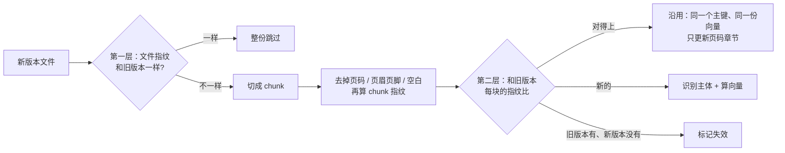

**关键**：算指纹之前先去掉「排版噪声」——页码、页眉页脚、多余空白、开头的文档标题。不然前面插了一页，后面所有 chunk 的页码都变了，指纹全变，增量就失效了。按章节切分也是为了让 chunk 的边界稳定。

---

## 5.1 指纹怎么算

📄 [app/kbase/ingest/clean.py:181](../assistant/app/kbase/ingest/clean.py#L181)

```python
def normalize_for_hash(chunk_text: str) -> str:
    """切片哈希用的文本：去掉开头的「【文档标题】」、页码标记、单独成行的页码、所有空白。章节标题保留（章节换了算内容变化）"""
    t = _HEAD.sub("", chunk_text.strip())
    t = _PAGE_MARK.sub("", t)
    t = "\n".join(line for line in t.split("\n") if not re.fullmatch(r"\s*(第\s*\d+\s*页|\d+\s*/\s*\d+|-\s*\d+\s*-)\s*", line))
    return re.sub(r"\s+", "", unicodedata.normalize("NFKC", t))
```

📄 [app/kbase/ingest/clean.py:189](../assistant/app/kbase/ingest/clean.py#L189)

```python
def norm_hash(chunk_text: str) -> str:
    return hashlib.sha256(normalize_for_hash(chunk_text).encode("utf-8")).hexdigest()
```

**单元测试里的例子**：

| 文本 | 指纹 |
|---|---|
| `【规格书 V1】技术参数` + 页码标记 + `额定转矩 2.39 N·m` + `第 3 页` | A |
| `【规格书 V2（改了标题）】技术参数` + `额定转矩  2.39 N·m` | **A（一样）**：只是标题、页码、空格不同 |
| `【规格书 V2】技术参数` + `额定转矩 2.40 N·m` | B（不一样）：数值真的变了 |

---

## 5.2 和旧版本比对

📄 [app/kbase/ingest/versioning.py:84](../assistant/app/kbase/ingest/versioning.py#L84)

```python
def diff(doc_key: str, version: str, chunks: list[dict]) -> dict:
    """chunks 已带 norm_hash。给每个 chunk 定 chunk_id 和 reused 标记；复用的带上原来的主题结果。返回统计"""
    current: dict[str, list[dict]] = {}
    for r in store.query("SELECT chunk_id, norm_hash, subject, item_name, series FROM kb_chunk WHERE doc_key = %s AND state = 'VALID' "
                         "ORDER BY chunk_seq", (doc_key,)):
        current.setdefault(r["norm_hash"], []).append(r)
    used = set()
    for c in chunks:
        same = current.get(c["norm_hash"]) or []
        if same:                                               # 同一份文档里有两块一模一样的内容时，按顺序一对一复用
            old = same.pop(0)
            used.add(old["chunk_id"])
            c.update(chunk_id=old["chunk_id"], reused=True, subject=_loads(old["subject"]) or None,
                     item_name=old["item_name"] or c.get("item_name", ""), series=old["series"] or "")
        else:
            c.update(chunk_id=chunk_id(doc_key, version, c["seq"]), reused=False)
    vanished = [r["chunk_id"] for rows in current.values() for r in rows if r["chunk_id"] not in used]
    return {"new": sum(1 for c in chunks if not c["reused"]), "reused": sum(1 for c in chunks if c["reused"]), "vanished": len(vanished)}


# ---------------------------------------------------------------- 暂存
```

**注解**
- 当前生效的 chunk 按指纹分组；新版本的每块拿指纹去找，找到就「领走」那个旧 chunk 的主键、主体识别结果
- 同一份文档里两块内容一模一样时，一对一复用，多出来的算新增
- 没被领走的旧 chunk 就是「消失」的，切换时标记失效

**自测里的真实结果**：改了第 1 节、删了第 3 节、加了第 4 节 → 新增 2、沿用 1、消失 2；沿用的那块主键没变、没有重新向量化。

---

## 6. 分层存储：什么数据放哪

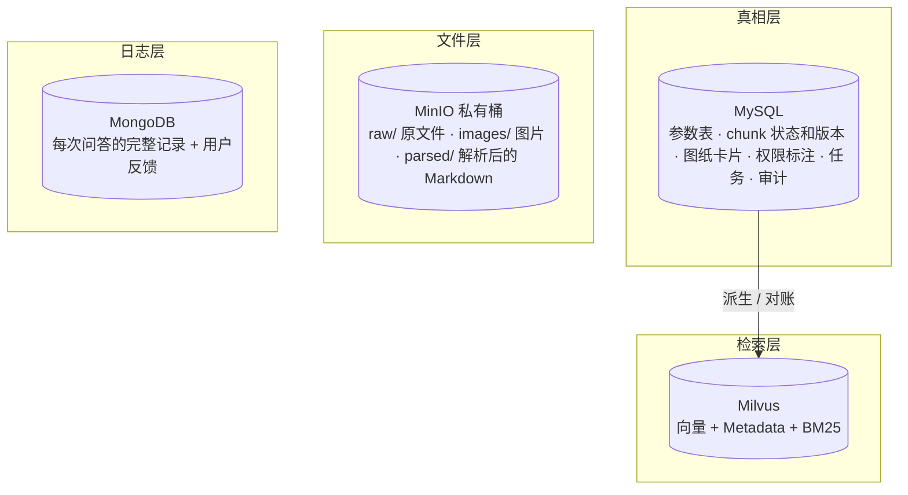

| 存储 | 为什么选它 |
|---|---|
| Milvus | 向量检索 + 标量过滤（权限、状态、型号）在检索时一起做；2.5 起内置 BM25 |
| MySQL | 参数要精确查询（比大小、排序），版本切换要事务 |
| MinIO | 文件大、二进制，S3 协议，能签临时链接 |
| MongoDB | 问答日志结构不固定（召回条数、引用条数都不一样），嵌套存最自然 |

---

## 6.1 图文关联：图片按生效版本关联，现签临时链接

大白话：图片存在私有桶里，没有能直接访问的地址。用户要看图时，服务先检查「你能不能看这份文档、这张图是不是当前生效版本的」，通过了才签一个几分钟就过期的链接。

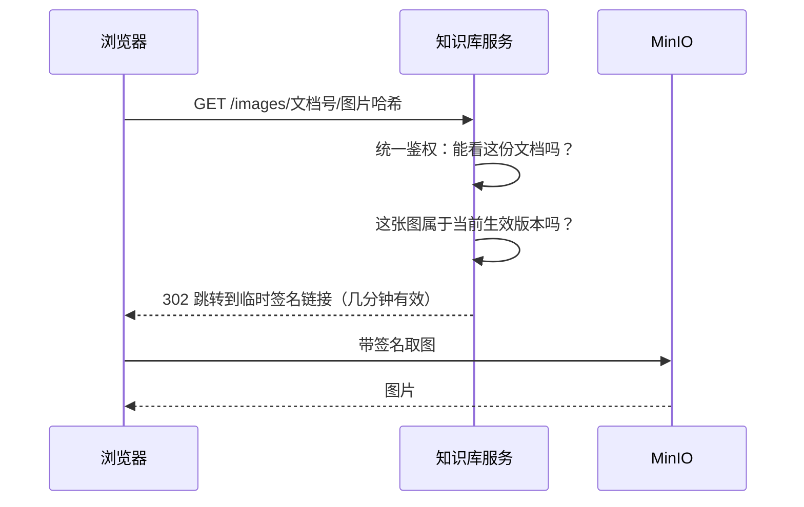

📄 [app/kbase/server.py:363](../assistant/app/kbase/server.py#L363)

```python
@app.get("/images/{doc_key}/{sha}")
def image(doc_key: str, sha: str, who: Who = Depends(current_who)):
    """文档图片：先按统一授权判断能不能看这份文档，再确认图片属于生效版本，最后跳转到几分钟有效的临时签名链接"""
    d = store.one("SELECT security_level, acl_groups, active_version FROM kb_document WHERE doc_key = %s", (doc_key,))
    if not d or not who.scope.can_view(d["security_level"], d["acl_groups"]):
        raise HTTPException(status_code=404, detail="图片不存在或无权查看")
    img = store.one("SELECT object_key FROM kb_image WHERE doc_key = %s AND version = %s AND sha = %s", (doc_key, d["active_version"], sha[:16]))
    if not img:
        raise HTTPException(status_code=404, detail="图片不存在或不属于当前生效版本")
    from app.infra.object_storage.minio_gateway import minio_gateway
    return RedirectResponse(minio_gateway.presigned_url(img["object_key"], settings.kbase_image_ttl), status_code=302)
```

📄 [app/infra/object_storage/minio_gateway.py:54](../assistant/app/infra/object_storage/minio_gateway.py#L54)

```python
    def presigned_url(self, object_name: str, seconds: int = 600) -> str:
        """临时签名链接：过期失效，链接本身不带账号信息。签名里包含主机名，所以用浏览器能访问的地址（MINIO_PUBLIC_BASE）建一个只用来签名的客户端，
        不能签完再替换主机"""
        if self._signer is None:
            from urllib.parse import urlparse
            u = urlparse(settings.minio_public_base or ("http://" + settings.minio_endpoint))
            self._signer = Minio(u.netloc, access_key=settings.minio_access_key, secret_key=settings.minio_secret_key,
                                 secure=u.scheme == "https", region="us-east-1")       # 指定区域，签名时不用联网查桶的位置
        return self._signer.presigned_get_object(self.bucket, object_name, expires=timedelta(seconds=seconds))
```

**注解**：签名里包含主机名，所以要用浏览器能访问的地址建一个专门签名的客户端，**不能签完再替换主机名**（会导致签名失效）。Markdown 里写的是 `kbimg://哈希.png`，不写存储地址。

---

## 7. 参数结构化：规格书 → 「型号–参数–数值–单位」

**为什么**：向量检索分不清 750 和 400、Φ19 和 Φ14 这种相近的数。凡是问数值的，必须从结构化数据里取。

📄 [app/kbase/ingest/params.py:69](../assistant/app/kbase/ingest/params.py#L69)

```python
def from_markdown(md: str, model: str, source: str = "") -> list[dict]:
    """从规格书的"参数｜数值"表格和"- 名称：值"列表里抽参数。只收能对上标准参数名的行"""
    out, seen = [], set()

    def add(name: str, raw: str, ref: str) -> None:
        key = param_key(name)
        if not key or key in seen or not raw.strip():
            return
        num, text, unit = parse_value(raw)
        seen.add(key)
        out.append({"model": model, "param_key": key, "param_name": name.strip(), "value_num": num, "value_text": text[:200],
                    "unit": unit, "source_ref": ref})

    section = ""
    for line in md.split("\n"):
        s = line.strip()
        if s.startswith("#"):
            section = s.lstrip("# ").strip()
        elif s.startswith("|") and not re.fullmatch(r"\|[\s:|\-]+\|", s):
            cells = [c.strip() for c in s.strip("|").split("|")]
            if len(cells) == 2 and cells[0] not in ("参数", "项目", "名称"):
                add(cells[0], cells[1], f"{source} {section}".strip())
        else:
            m = re.match(r"^[-*]\s*([^：:]{2,12})[：:]\s*(.+)$", s)
            if m:
                add(m.group(1), m.group(2), f"{source} {section}".strip())
    return out
```

**注解**：同一个参数在不同文档里叫法不同（额定转矩 / 额定扭矩 / Rated Torque），`param_key` 统一成一个标准名；数值和单位拆开存（`value_num` 能比大小，「功率最大的伺服是哪个」直接 SQL 排序）。

---

## 8. 图纸结构化：为什么难

**图纸不是图片，是一堆「线 + 字 + 标注」**。直接读矢量数据是精确值；OCR 会把 Φ19 读成 019、公差读丢。

**三个难点**：
1. **尺寸值不在文字属性里**：标注显示的文字存在「标注几何块」里；公差是 `\S+0.009^-0.004;` 这种堆叠格式
2. **明细表不是表格对象**：是几十条直线和单行文字拼出来的，读出来的顺序是乱的；GB 明细栏还是表头在下、从下往上排
3. **图纸可能被「炸开」过**：标注变成普通文字，没有任何结构

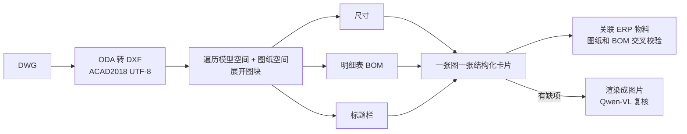

---

## 8.1 遍历：模型空间 + 图纸空间，块要展开

📄 [app/kbase/ingest/cad.py:186](../assistant/app/kbase/ingest/cad.py#L186)

```python
def _walk(layout, space: str, depth: int = 0, out: dict | None = None) -> dict:
    """收集文字、标注、线、圆、块属性。块参照递归展开（最多 5 层）"""
    out = out if out is not None else {"texts": [], "dims": [], "lines": [], "circles": [], "inserts": [], "expanded": 0}
    for e in layout:
        kind = e.dxftype()
        if kind == "INSERT":
            if e.attribs:                                      # 带属性的块（标题栏）：读属性，不展开
                out["inserts"].append({"name": e.dxf.name, "attribs": {a.dxf.tag: a.dxf.text for a in e.attribs}, "space": space})
                continue
            if depth < 5:
                try:
                    out["expanded"] += 1
                    _walk(list(e.virtual_entities()), space, depth + 1, out)
                except Exception as ex:
                    logger.warning(f"[cad] 块 {e.dxf.name} 展开失败：{ex}")
        elif kind == "DIMENSION":
            out["dims"].append((e, space))
        elif kind == "TEXT":
            out["texts"].append({"text": e.dxf.text, "x": e.dxf.insert.x, "y": e.dxf.insert.y, "h": e.dxf.get("height", 2.5), "layer": e.dxf.layer,
                                 "space": space, "stack": None})
        elif kind == "MTEXT":
            text, stack = mtext_plain(e.text)
            for i, line in enumerate(text.split("\n")):
                if line.strip():
                    out["texts"].append({"text": line.strip(), "x": e.dxf.insert.x, "y": e.dxf.insert.y - i * e.dxf.get("char_height", 2.5) * 1.6,
                                         "h": e.dxf.get("char_height", 2.5), "layer": e.dxf.layer, "space": space, "stack": stack if i == 0 else None,
                                         "mtext": text})
        elif kind == "LINE":
            out["lines"].append(((e.dxf.start.x, e.dxf.start.y), (e.dxf.end.x, e.dxf.end.y), e.dxf.layer, space))
        elif kind == "LWPOLYLINE":
            pts = [tuple(p[:2]) for p in e.get_points("xy")]
            if e.closed and pts:
                pts.append(pts[0])
            out["lines"] += [(a, b, e.dxf.layer, space) for a, b in zip(pts, pts[1:])]
    # ……（后面省略，完整代码见链接）
```

**注解**：图纸里常把一个视图做成「块」反复引用，不展开就读不到里面的标注；但标题栏块只读属性（图号、名称……），不展开。

---

## 8.2 尺寸：按优先级取值

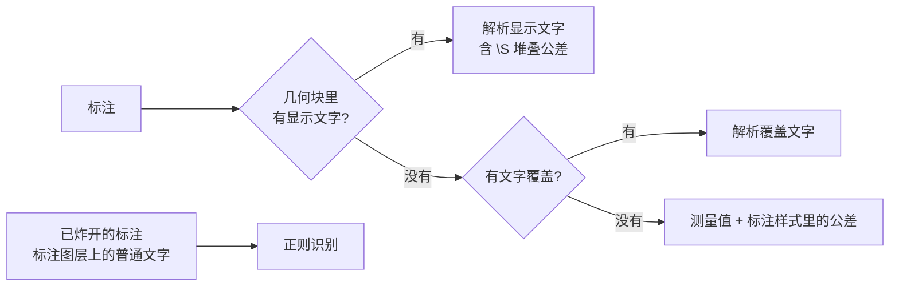

📄 [app/kbase/ingest/cad.py:38](../assistant/app/kbase/ingest/cad.py#L38)

```python
def mtext_plain(raw: str) -> tuple[str, tuple[float, float] | None]:
    """MTEXT 原始串 → （纯文字, 堆叠公差）。\\S+0.009^ -0.004; 是上下偏差堆叠；其余格式码（\\A0; \\H0.6x; {}）去掉"""
    stack = None
    m = re.search(r"\\S\s*([+\-]?\s*\d*\.?\d+)\s*[\^/#]\s*([+\-]?\s*\d*\.?\d+)\s*;", raw)
    if m:
        stack = (float(m.group(1).replace(" ", "")), float(m.group(2).replace(" ", "")))
        raw = raw[:m.start()] + raw[m.end():]
    t = raw.replace("\\P", "\n")                                # 段落换行先保留下来
    t = re.sub(r"\\[ACcFfHhQTWp][^;]*;", "", t)
    t = re.sub(r"\\[LlOoKkNX]", "", t).replace("{", "").replace("}", "")
    return t.strip(), stack
```

**例子**：`\A0;%%c70{\H0.60x;\S 0.000^ -0.030;}` → 文字 `%%c70`（%%c 就是 Φ），公差 (0, -0.03) → Φ70 上偏差 0 下偏差 -0.03。

---

## 8.3 尺寸：统一解析成「基本尺寸 / 上下偏差 / 配合 / 数量」

📄 [app/kbase/ingest/cad.py:56](../assistant/app/kbase/ingest/cad.py#L56)

```python
def parse_dim_text(text: str, stack: tuple | None = None, measurement: float | None = None) -> dict | None:
    """一串标注文字 → {kind, value, plus, minus, fit, count, pitch, text}。认不出返回 None"""
    t = _symbols(text).replace("<>", f"{measurement:g}" if measurement is not None else "").strip()
    t = re.sub(r"\s+", "", t)
    out = {"text": text, "plus": None, "minus": None, "fit": None, "count": None, "pitch": None}
    m = re.match(rf"^(\d+)[x\-](?=[ΦRM]|{_NUM})", t)
    if m:
        out["count"], t = int(m.group(1)), t[m.end():]
    if t.startswith("M") and re.match(rf"^M{_NUM}", t):
        m = re.match(rf"^M({_NUM})(?:x({_NUM}))?(?:-?(\d[gGhH]|\d[gGhH]\d[gGhH]))?", t)
        out.update(kind="thread", value=float(m.group(1)), pitch=float(m.group(2)) if m.group(2) else None, fit=m.group(3))
        return out
    kind = "linear"
    if t.startswith("Φ"):
        kind, t = "dia", t[1:]
    elif t.startswith("R") and re.match(rf"^R{_NUM}", t):
        kind, t = "radius", t[1:]
    elif t.startswith("SΦ"):
        kind, t = "dia", t[2:]
    m = re.match(rf"^({_NUM})", t)
    if not m:
        if measurement is None:
            return None
        value, rest = float(measurement), t
    else:
        value, rest = float(m.group(1)), t[m.end():]
    if rest.startswith("°"):
        kind, rest = "angle", rest[1:]
    m = re.match(rf"^±({_NUM})", rest)
    if m:
        out["plus"], out["minus"], rest = float(m.group(1)), -float(m.group(1)), rest[m.end():]
    m = _FIT.match(rest)
    if m:
        out["fit"], rest = m.group(0), rest[m.end():]
    m = re.match(rf"^\(?([+\-]{_NUM})[/^]?([+\-]?{_NUM})?\)?", rest)        # 平铺写法：19+0.009-0.004 或 (+0.009/-0.004)
    if m and out["plus"] is None:
        a, b = float(m.group(1)), float(m.group(2)) if m.group(2) else 0.0
        out["plus"], out["minus"] = max(a, b), min(a, b)
    if stack and out["plus"] is None:
        out["plus"], out["minus"] = max(stack), min(stack)
    # ……（后面省略，完整代码见链接）
```

**单元测试覆盖的写法**：

| 原文 | 解析结果 |
|---|---|
| `4×%%c6` / `4-Φ6.6` | 直径 6 / 6.6，数量 4（安装孔） |
| `M5x0.8-6H` | 螺纹 M5，螺距 0.8，公差带 6H |
| `R3` | 半径 3 |
| `Φ22H7` / `Φ22H7/g6` | 直径 22，配合 H7 / H7/g6 |
| `50%%p0.1` | 50 ±0.1 |
| `Φ19+0.009-0.004` | 直径 19，+0.009 / -0.004 |

---

## 8.4 明细表（BOM）：从直线和文字还原成表格

```
 ┌────┬──────────┬──────────────────────┬────┐
 │ 3  │ M-KEY-5  │ 平键 5×5×20          │ 1  │   ← GB 明细栏：序号从下往上
 ├────┼──────────┼──────────────────────┼────┤
 │    │          │ （含防尘盖，C3 游隙）  │    │   ← 续行：只有名称 → 接到第 2 项
 ├────┼──────────┼──────────────────────┼────┤
 │ 2  │ M-BR-6202│ 深沟球轴承 6202-2RS   │ 2  │
 ├────┼──────────┼──────────────────────┼────┤
 │ 1  │ M-SH-14  │ 转轴 Φ14             │ 1  │
 ├────┼──────────┼──────────────────────┼────┤
 │序号│ 代号     │ 名称                  │数量│   ← 表头在最下面
 └────┴──────────┴──────────────────────┴────┘
```

步骤：找到表头 → 看正文在表头上方多还是下方多（上方多 = GB 明细栏）→ 用横线定行、竖线定列，每个字按坐标落进格子 → 线不全时按纵坐标聚类 → 按填写方向合并续行 → 按序号排序。

📄 [app/kbase/ingest/cad.py:254](../assistant/app/kbase/ingest/cad.py#L254)

```python
def bom_table(texts: list[dict], lines: list[tuple]) -> dict:
    """返回 {rows: [[序号, 代号, 名称, 数量]], extra: [{材料, 备注}], method, bottom_up}"""
    heads = [t for t in texts if t["text"].strip() in _HEAD]
    if len({_HEAD[t["text"].strip()] for t in heads}) < 3:
        return {"rows": [], "extra": [], "method": None, "bottom_up": False}
    hy = sorted(t["y"] for t in heads)[len(heads) // 2]
    head = {}
    for t in sorted(heads, key=lambda t: abs(t["y"] - hy)):
        head.setdefault(_HEAD[t["text"].strip()], t)
    space = head["seq"]["space"] if "seq" in head else heads[0]["space"]
    h = max(t["h"] for t in head.values())
    xs = sorted(t["x"] for t in head.values())
    x0, x1 = xs[0] - 15, xs[-1] + 60
    cand = [t for t in texts if t["space"] == space and x0 <= t["x"] <= x1 and t not in head.values() and abs(t["y"] - hy) > h * 0.5]
    above = [t for t in cand if t["y"] > hy and t["y"] - hy < 200]
    below = [t for t in cand if t["y"] < hy and hy - t["y"] < 200]
    body = above if bottom_up else below
    hs = [(a, b) for a, b, _, sp in lines if sp == space and abs(a[1] - b[1]) < 0.01 and min(a[0], b[0]) <= x0 + 20 and max(a[0], b[0]) >= xs[-1]]
    vs = [(a, b) for a, b, _, sp in lines if sp == space and abs(a[0] - b[0]) < 0.01 and x0 <= a[0] <= x1]
    ys = _cluster([a[1] for a, _ in hs], 0.5)
    vx = _cluster([a[0] for a, _ in vs], 0.5)
    cols = {k: t["x"] for k, t in head.items()}
    method = "grid"
    if len(ys) >= 3 and len(vx) >= 3:
        def cell(x: float) -> int:
            return bisect_right(vx, x + 0.5) - 1

        rows: dict[float, dict] = {}
        for t in body:
            row = max((v for v in ys if v <= t["y"] + 0.5), default=None)  # 文字所在行 = 它下面最近的那条横线
    # ……（后面省略，完整代码见链接）
```

---

## 8.5 标题栏、结构化卡片、ERP 交叉校验

**标题栏**：读块属性，中英文属性名都认（`DWG_NO` / `图号` / `图样代号`……）。

**结构化卡片**：一张图一张，包括标题栏、全部尺寸（带来源：几何块 / 测量值 / 炸开的文字）、关键安装尺寸、明细表、技术要求、缺了什么。

**交叉校验**（规则判断，不让模型判断）：

📄 [app/kbase/ingest/parsers.py:260](../assistant/app/kbase/ingest/parsers.py#L260)

```python
def cross_check(drawing: dict, product_code: str | None) -> tuple[list[str], set[str]]:
    """图纸和金蝶数据的交叉校验（确定性规则，不让模型判断）。返回（发现的问题, 在金蝶里能对上的物料编码）"""
    issues, matched = [], set()
    codes = [r[1].strip() for r in drawing["bom"] if r[1].strip()]
    if codes:
        known = {r["f_number"]: r for r in store.query("SELECT f_number, f_name FROM kd_material WHERE f_number IN %s", (codes,))}
        matched = set(known)
        for c in codes:
            if c not in known:
                issues.append(f"图纸明细表里的物料 {c} 在金蝶物料档案里不存在")
    erp = {}
    if product_code:
        if not store.one("SELECT 1 FROM kd_material WHERE f_number = %s", (product_code,)):
            issues.append(f"图纸对应的产品 {product_code} 在金蝶物料档案里不存在")
        erp = {r["f_child"]: float(r["qty"]) for r in store.query(
            "SELECT f_child, f_numerator / NULLIF(f_denominator, 0) AS qty FROM kd_bom WHERE f_parent = %s", (product_code,))}
    for _, code, name, qty in drawing["bom"]:
        code = code.strip()
        try:
            q = float(qty)
        except ValueError:
            continue
        if not name.lstrip().startswith("└") and code in erp and abs(erp[code] - q) > 1e-6:      # 只比一级子件
            issues.append(f"物料 {code} 的用量不一致：图纸 {q:g}，金蝶 BOM {erp[code]:g}")
    shaft = drawing["dims"].get("shaft_dia", {}).get("value")
    for _, code, name, _q in drawing["bom"]:
    # ……（后面省略，完整代码见链接）
```

**注解**：校验出的问题入库时写进告警表，并发通知给图纸负责人；用户问到这个型号时，回答里也会提醒「图纸和 ERP 不一致」。抽取不完整的图纸会渲染成 PNG 交给 Qwen-VL 复核标题栏和明细栏。

**测试图纸**：`scripts/make_cad_gb_sample.py` 造了一张覆盖所有难点的 GB 图纸；原有 6 张图纸的解析结果和数据库里存的逐行一致。

---

## 9. 问答：整条链路

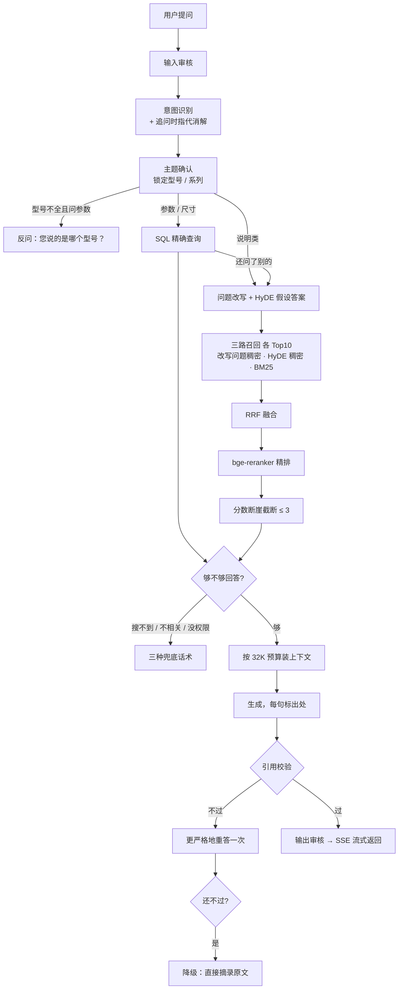

---

## 9.1 意图识别：规则就够，不调大模型

📄 [app/kbase/query/intent.py:71](../assistant/app/kbase/query/intent.py#L71)

```python
def classify(question: str) -> dict:
    """规则判断路线"""
    models, keys = find_models(question), find_params(question)
    cmp_ = _CMP.search(question)
    aggregate = bool(keys) and (bool(_SUPER.search(question)) or bool(cmp_))
    desc = bool(_DESC.search(question)) or has_extra_ask(question)
    want_bom = bool(re.search(r"BOM|物料清单|明细表|用了哪些|用到哪些|由哪些.*组成|用量", question, re.I))
    if (models and (keys or want_bom)) or aggregate:
        route = "MIXED" if desc else "PARAM"
    else:
        route = "DESC"
    return {"route": route, "models": models, "param_keys": keys, "series": find_series(question), "want_bom": want_bom,
            "superlative": _SUPER.search(question).group(0) if _SUPER.search(question) else None,
            "compare": (cmp_.group(1), float(cmp_.group(2))) if cmp_ else None}
```

**注解**：首轮提问用规则判断（有没有型号、有没有参数名、有没有「为什么 / 怎么处理」这类词），毫秒级；只有带指代的追问（「它的轴径呢」）才调大模型结合历史补全问题。

---

## 9.2 主题确认：先锁定型号，不完整就反问

**为什么**：同系列规格书结构一样，不锁型号，向量检索会把 400W 的段落拿来回答 750W 的问题。

📄 [app/kbase/query/topic.py:43](../assistant/app/kbase/query/topic.py#L43)

```python
def resolve(question: str, plan: dict, session_lock: dict | None, has_history: bool) -> dict:
    """返回 {models, series, source, candidates, clarify}。clarify 为 True 时应该请用户先确认型号"""
    known = known_models()
    exact = [m for m in plan["models"] if m in known]
    partial = [m for m in plan["models"] if m not in known]
    cands = sorted({k for m in partial for k in known if k.startswith(m + "-") or (len(m) >= 8 and k.startswith(m))})
    series = plan.get("series")
    if exact and not partial:
        return {"models": exact, "series": series_of(exact[0]) or series, "source": "问题", "candidates": [], "clarify": False}
    if partial and len(cands) == 1:
        return {"models": [*exact, cands[0]], "series": series_of(cands[0]), "source": "补全", "candidates": cands, "clarify": False}
    if partial and cands:
        need_exact = plan["route"] in ("PARAM", "MIXED")
        return {"models": [*exact, *cands] if not need_exact else exact, "series": series_of(cands[0]), "source": "候选",
                "candidates": cands[:10], "clarify": need_exact and not exact}
    if not plan["models"] and has_history and session_lock and not series:
        return {**session_lock, "source": "上文", "candidates": [], "clarify": False}
    if series:
        return {"models": [], "series": series, "source": "问题", "candidates": [], "clarify": False}
    return {"models": exact, "series": series_of(exact[0]) if exact else None, "source": "无" if not exact else "问题", "candidates": [], "clarify": False}
```

**现场演示**：问「KL-SV-80 的额定转矩是多少？」→ 知识库里 80 法兰有 400W 和 750W 两个 → 参数不能猜，反问并列出两个候选，点一个就按那个型号重新问。说明类问题（「KL-SV-80 过热怎么办」）则两个型号都当过滤条件。追问时沿用上一轮锁定的型号。

---

## 9.3 HyDE：用「假设的答案」去找资料

**问题**：用户说「伺服电机**发烫**怎么办」，手册里写的是「**过热**报警的处理」。问题和答案的说法差得远，直接用问题去搜，容易漏。

**做法**：先让 Qwen3-32B 写一段「手册里大概会怎么写」的假设答案，用它的向量去搜，它和真正的答案段落更像。

| | 内容 |
|---|---|
| 原问题 | 伺服电机运行时发烫，可能是什么原因？ |
| 改写后 | 伺服电机运行时**过热**，可能是什么原因？ |
| HyDE 假设答案 | 伺服电机运行时出现过热，常见原因包括：负载率过高或长期过载运行，导致电机绕组温升…… |

（上表是真实运行一次的记录，存在 MongoDB 查询日志里）

📄 [app/kbase/query/prompts.py:40](../assistant/app/kbase/query/prompts.py#L40)

```python
REWRITE_HYDE = ("rewrite_hyde", "v1", """你在帮一个电机产品技术知识库做检索准备。对用户的问题做两件事：

1. rewritten：改写成一句不依赖上文、适合检索的完整问题。把"它""这个型号"换成对话历史里具体的型号；去掉寒暄；
   口语换成资料里的说法（例如"发烫"→"过热"，"跳闸"→"报警"）。问题本身已经完整就原样返回
2. hyde：假设你在一份技术手册里看到了这个问题的答案，写出那段话（80~150 字），用手册的写法，包括可能出现的术语、
   报警代码格式、操作步骤名称。这段话只用来检索相似的资料，不会给用户看，所以不确定的数值用「X」代替，不要编造具体数值

{subject}更早对话的摘要：{summary}
最近的对话：
{history}

用户的问题：{question}

只输出 JSON：{{"rewritten": "...", "hyde": "..."}}""")
```

**注解**：一次调用同时出改写和假设答案，省一次延迟；假设答案只用来检索，**不给用户看**；不确定的数值用 X 代替，防止编造的数字被当成依据。生成失败就跳过这一路（降级），不影响回答。

---

## 9.4 三路召回 + RRF 融合

| 路 | 用什么搜 | 擅长什么 |
|---|---|---|
| 稠密 | 改写后问题的向量 | 意思相近 |
| HyDE | 假设答案的向量 | 口语和术语差得远的问题 |
| BM25 | 关键词 | 型号、报警代码（AL.060）这种必须字面命中的 |

**RRF 怎么合并**：三路的分数不在一个尺度上（余弦相似度、BM25 分数），不能直接相加。RRF 只看**名次**：每一路里排第 r 名得 1/(60+r) 分，加起来排序。三路都排前面的，总分最高。

📄 [app/kbase/query/retrieve.py:98](../assistant/app/kbase/query/retrieve.py#L98)

```python
def rrf(lists: dict[str, list[dict]]) -> list[dict]:
    fused: dict[str, dict] = {}
    for route, hits in lists.items():
        for rank, h in enumerate(hits):
            item = fused.setdefault(h["chunk_id"], {**h, "rrf": 0.0, "routes": {}})
            item["rrf"] += 1.0 / (RRF_K + rank + 1)
            item["routes"][route] = rank + 1
    return sorted(fused.values(), key=lambda x: -x["rrf"])
```

📄 [app/kbase/query/retrieve.py:125](../assistant/app/kbase/query/retrieve.py#L125)

```python
def recall(queries: dict, scope, models: list[str] | None = None, series: str | None = None, mode: str = "multi", limit: int = RECALL,
           embeddings: dict | None = None) -> list[dict]:
    """queries：{"rewritten": 改写后的问题, "hyde": 假设答案或空}。mode 见 ROUTES（multi 是默认的三路，其他做消融对比）。
    embeddings 可以把已经算好的向量传进来（{"rewritten": ..., "hyde": ...}）"""
    routes = [r for r in ROUTES[mode] if r != "hyde" or queries.get("hyde")]
    need = (["rewritten"] if {"dense", "sparse"} & set(routes) else []) + (["hyde"] if "hyde" in routes else [])
    embs = dict(embeddings or {})
    missing = [k for k in need if k not in embs]
    if missing:
        for k, v in zip(missing, embed_many([queries[k] for k in missing])):
            embs[k] = v
    payload = {"dense": (embs.get("rewritten") or {}).get("dense"), "hyde": (embs.get("hyde") or {}).get("dense"),
               "sparse": (embs.get("rewritten") or {}).get("sparse"), "bm25": queries["rewritten"]}
    expr = _expr(scope, models, series)
    jobs = {r: _pool.submit(_traced_route, tracing.current(), r, payload[r], expr, limit) for r in routes if payload[r]}
    lists = {r: f.result() for r, f in jobs.items()}
    out = _only_valid(rrf(lists))                              # 三路各 limit 条，合并去重后全部交给精排
    if (models or series) and len(out) < 3:                    # 按主题过滤后太少：放开主题限制再召回一次
        return recall(queries, scope, None, None, mode, limit, embs)
    return out
```

---

## 9.5 精排 + 分数断崖截断

**精排**：召回的二三十条，用 bge-reranker 逐条和问题一起读、打 0~1 的分。比向量相似度准，但慢，所以只对召回结果做。

**断崖截断**：分数排好后，如果后一条比前一条明显低一截（差 > 0.25，或少了一半以上），后面的就不要了；最多留 3 条。

```
精排分数：  0.97  0.95  0.41  0.38  0.12
                       ↑ 断崖（0.95 → 0.41）
留下：      0.97  0.95
```

📄 [app/kbase/query/retrieve.py:36](../assistant/app/kbase/query/retrieve.py#L36)

```python
def dynamic_topk(docs: list[dict], max_k: int = FINAL, min_k: int = 2, gap_abs: float = 0.25, gap_ratio: float = 0.5,
                 min_score: float = 0.05) -> list[dict]:
    """docs 已按分数降序。先按最低分过滤（至少保留 1 条），再在分数断崖处截断：后面的明显差一截就不要了"""
    kept = [d for d in docs if d["score"] >= min_score] or docs[:1]
    upper = min(max_k, len(kept))
    k = upper
    for i in range(min_k - 1, upper - 1):
        cur, nxt = kept[i]["score"], kept[i + 1]["score"]
        if cur - nxt > gap_abs or (cur > 0 and (cur - nxt) / cur > gap_ratio):
            k = i + 1
            break
    return kept[:k]
```

**为什么最多 3 条**：单变量调参里，3 条时给模型的资料里有用的占比 35.6%（5 条只有 25%），再多只是多塞噪声；2 条占比更高但开始丢命中（前 3 条命中率从 98.1% 掉到 97.4%）。

---

## 9.6 32K 上下文预算

大白话：Qwen3-32B 一次最多看 32K token。按顺序分配：先给回答留 2K → 提示词和问题 → 历史对话（最多 3K，太长先丢最早的轮次，摘要保留）→ 剩下的全给资料，按相关度依次装，最后一条装不下就截到段落边界，再装不下就丢掉并记录。

📄 [app/kbase/query/answer.py:55](../assistant/app/kbase/query/answer.py#L55)

```python
def pack(question: str, sources: list[dict], history: str, subject_line: str = "", budget: int | None = None,
         reserve: int | None = None, history_cap: int = 3000) -> tuple[list[dict], str, dict]:
    """按 token 预算装上下文。返回（装进去的资料，可能有截断；对话历史文本；预算明细）"""
    budget = budget or settings.kbase_context_budget
    reserve = reserve if reserve is not None else settings.kbase_answer_reserve
    fixed = tokens(prompts.text(prompts.ANSWER)) + tokens(prompts.text(prompts.STRICT)) + tokens(question) + tokens(subject_line)
    hist = history if tokens(history) <= history_cap else _cut_history(history, history_cap)
    room = budget - reserve - fixed - tokens(hist)
    used, out, dropped, truncated = 0, [], [], []
    for s_ in sources:
        label = 60                                             # 编号和出处那一行
        need = tokens(s_["context"]) + label
        if used + need <= room:
            out.append(s_)
            used += need
        elif room - used > 300:
            out.append({**s_, "context": _cut(s_["context"], room - used - label), "truncated": True})
            truncated.append(s_["index"])
            used = room
        else:
            dropped.append(s_["index"])
    for i, s_ in enumerate(out, start=1):                      # 丢掉的资料不留空号：重新编号，出处列表也跟着用新编号
        s_["index"] = i
    stats = {"budget": budget, "reserve": reserve, "fixed": fixed, "history": tokens(hist), "evidence": used, "total": fixed + tokens(hist) + used,
             "sources_in": len(out), "truncated": truncated, "dropped": dropped}
    return out, hist, stats
```

**注解**：中文按 1 个字 1 个 token、其他按 3.5 个字符 1 个 token 估，偏保守，不会超；装了几条、截了哪条、丢了哪条都记进链路和查询日志。

---

## 9.7 生成 + 出处 + 引用校验

**提示词要求**：只根据给的资料回答；每个结论后面标 `[编号]`；数值照抄不换算；资料不够就说「没有找到」。每条资料前面标着文档号、版本、章节、页码，界面据此显示出处。

**校验**（代码判断，不靠模型自觉）：

📄 [app/kbase/query/answer.py:139](../assistant/app/kbase/query/answer.py#L139)

```python
def verify(answer: str, sources: list[dict]) -> tuple[bool, str]:
    """引用校验。返回（是否通过, 问题说明）"""
    if no_answer(answer):
        return True, ""
    cited = {int(n) for n in _CITE.findall(answer)}
    valid = {s["index"] for s in sources}
    if not cited:
        return False, "回答没有标注任何出处"
    if cited - valid:
        return False, f"引用了不存在的编号 {sorted(cited - valid)}"
    pool = re.sub(r"[\s,，]", "", " ".join(s["context"] for s in sources if s["index"] in cited))
    loose = []
    for m in _NUM.finditer(_CITE.sub("", answer)):
        n = m.group(0)
        if len(n.replace(".", "")) < 2:                       # 一位数太容易巧合，不查
            continue
        if n not in pool and n.rstrip("0").rstrip(".") not in pool:
            loose.append(n)
    if loose:
        return False, f"数值 {'、'.join(loose[:5])} 在引用的资料里找不到"
    return True, ""
```

**不过怎么办**：把问题告诉模型，更严格地重答一次；还不过就不让模型说了，直接摘录原文给用户（宁可不好看，也不能说没有依据的话）。

---

## 9.8 流式输出、多轮对话

**SSE 流式**：FastAPI 一边生成一边推，用户先看到进度（「理解问题 → 确认主题 → 检索文档 → 重排序 → 生成回答」），再看到出处，最后一个字一个字出答案。

**多轮对话**：
- 指代消解：「它的轴径呢？」→ 结合上文改写成「KL-SV-80-750W 的轴径是多少？」
- 历史摘要压缩：最近 3 轮保留原文，更早的压缩成一段 150 字以内的摘要（保留聊过的型号、参数、结论），压缩放在回答之后的后台线程里做，不占用户等待时间

📄 [app/kbase/query/memory.py:32](../assistant/app/kbase/query/memory.py#L32)

```python
def compress(session_id: str) -> str | None:
    """把最近 KEEP_TURNS 轮之前、还没进摘要的对话并入摘要。没有需要压缩的内容时返回 None"""
    doc = _summaries().find_one({"session_id": session_id}) or {}
    rows = list(_messages().find({"session_id": session_id}).sort("ts", 1))
    old = [r for r in rows[:-KEEP_TURNS * 2] if r["ts"] > doc.get("upto_ts", 0)] if len(rows) > KEEP_TURNS * 2 else []
    if len(old) < COMPRESS_EVERY * 2:
        return None
    dialogue = "\n".join(f"{'用户' if r['role'] == 'user' else '助手'}：{r['text'][:400]}" for r in old)
    summary = llm.invoke(prompts.text(prompts.SUMMARY).format(summary=doc.get("summary") or "（无）", dialogue=dialogue)).content.strip()[:400]
    _summaries().update_one({"session_id": session_id}, {"$set": {"summary": summary, "upto_ts": old[-1]["ts"], "turns": len(rows) // 2 - KEEP_TURNS}}, upsert=True)
    logger.info(f"[kbase] 会话 {session_id[:8]} 压缩了 {len(old) // 2} 轮历史：{summary[:60]}")
    return summary
```

---

## 10. 权限：谁能看什么

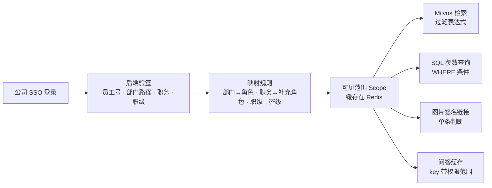

**一句话**：同一个 `Scope` 对象生成三种过滤条件，向量检索、SQL 查询、图片链接三处用的是**同一套规则**，不会出现「搜不到但能看到图」这种漏洞。

**文档怎么标注**：可见范围写 `ALL`（全员）、角色名（`ENGINEER`）或部门（`D:研发中心编号`），密级必填。**没标注的文档谁都看不到**，入库时也会拒收。

---

## 10.1 Scope：一个对象，三种过滤条件

📄 [app/kbase/authz.py:34](../assistant/app/kbase/authz.py#L34)

```python
@dataclass(frozen=True)
class Scope:
    user: str
    tokens: tuple[str, ...]                   # 已排序、去重
    clearance: int
    admin: bool = False                       # 管理员：所有已标注的文档都能看（未标注的照样看不到）
    source: str = "erp"                       # erp：MiniERP 账号；sso：公司 SSO
    employee_no: str | None = None
    notes: tuple[str, ...] = field(default=())  # 解析身份时的异常说明（用了缓存、没匹配到角色……），展示给用户

    @staticmethod
    def build(user: str, tokens, clearance: int, **kw) -> "Scope":
        return Scope(user, tuple(sorted({"ALL", *tokens})), int(clearance), **kw)

    @staticmethod
    def for_role(role: str, user: str = "") -> "Scope":
        role = (role or "").upper()
        return Scope.build(user or role, [role] if role else [], ROLE_CLEARANCE.get(role, DEFAULT_CLEARANCE), admin=role == "ADMIN")

    @property
    def role(self) -> str:
        """兼容旧代码：第一个角色标记（不是 ALL、不是部门）"""
        return "ADMIN" if self.admin else next((t for t in self.tokens if t != "ALL" and not t.startswith("D:")), "")

    def key(self) -> str:
        """缓存用：可见范围相同 → key 相同"""
        raw = "|".join(self.tokens) + f"#{self.clearance}#{int(self.admin)}"
        return hashlib.md5(raw.encode()).hexdigest()[:16]

    # ---------- 三种过滤条件 ----------

    def milvus_expr(self) -> str:
        """检索前置过滤：先过滤再取 TopK。未标注的切片 level 是 -1，永远不满足 level >= 0"""
        lvl = f"level >= 0 and level <= {self.clearance}"
        if self.admin:
            return lvl
        return f'{lvl} and array_contains_any(acl, [{", ".join(chr(34) + escape(t) + chr(34) for t in self.tokens)}])'

    def sql(self, alias: str = "d") -> tuple[str, list]:
        """SQL 条件和参数，拼在 WHERE 后面。kb_document 的 sec_level 是数字密级，acl_groups 是逗号分隔的标记"""
        base = f"({alias}.acl_groups <> '' AND {alias}.sec_level IS NOT NULL AND {alias}.sec_level <= %s"
        if self.admin:
            return base + ")", [self.clearance]
        ors = " OR ".join(f"FIND_IN_SET(%s, {alias}.acl_groups)" for _ in self.tokens)
        return f"{base} AND ({ors}))", [self.clearance, *self.tokens]

    def can_view(self, security_level: str | int | None, acl_groups: str | None) -> bool:
        lvl = security_level if isinstance(security_level, int) else level_of(security_level)
        acl = parse_acl(acl_groups)
        if lvl is None or not acl or lvl > self.clearance:
            return False
        return self.admin or bool(set(acl) & set(self.tokens))
```

**部门怎么继承**：SSO 给的是从根到本部门的完整路径（科朗 → 研发中心 → 伺服研发部），每一级都变成一个标记。文档授权给「研发中心」，伺服研发部的人身上带着研发中心的标记，自然能看。

---

## 10.2 公司 SSO 登录

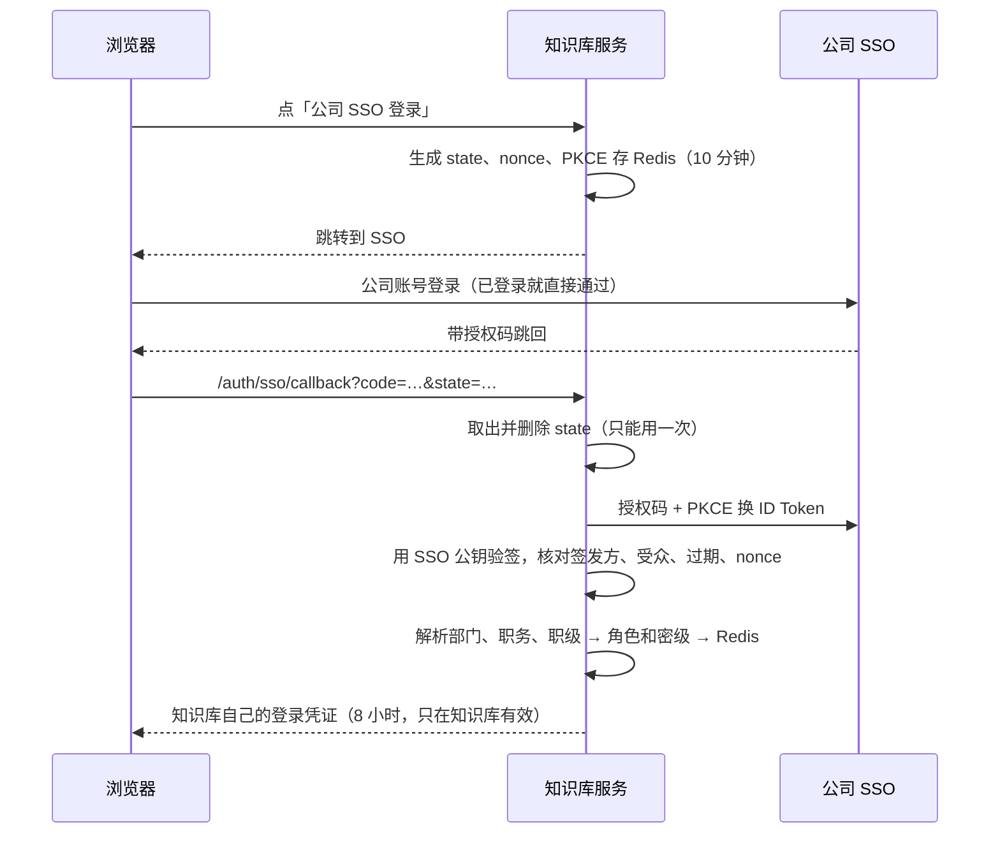

📄 [app/kbase/auth/sso.py:76](../assistant/app/kbase/auth/sso.py#L76)

```python
def exchange(code: str, verifier: str, nonce: str) -> dict:
    """授权码换 ID Token 并验签，返回声明"""
    try:
        r = _session.post(discovery()["token_endpoint"], timeout=TIMEOUT, data={
            "grant_type": "authorization_code", "code": code, "redirect_uri": settings.sso_redirect_uri, "client_id": settings.sso_client_id,
            "client_secret": settings.sso_client_secret, "code_verifier": verifier})
    except requests.RequestException as e:
        raise SSOUnavailable(f"换取令牌失败：{type(e).__name__}") from e
    if r.status_code >= 500:
        raise SSOUnavailable(f"SSO 返回 {r.status_code}")
    body = r.json()
    if "id_token" not in body:
        raise SSOError(f"换取令牌失败：{body.get('error_description') or body.get('error')}")
    claims = verify(body["id_token"])
    if claims.get("nonce") != nonce:
        raise SSOError("nonce 对不上，可能是重放")
    return claims
```

**注解**：身份只在后端从 SSO 拿，前端传什么都不信；知识库签的凭证用独立密钥，拿去调 ERP 接口无效（我们测过，返回 401）。

---

## 10.3 身份 → 角色和密级

📄 [app/kbase/auth/principal.py:44](../assistant/app/kbase/auth/principal.py#L44)

```python
def derive(claims: dict) -> dict:
    """按规则算角色和密级"""
    r = rules()
    path = claims.get("dept_path") or []
    title, level_code = claims.get("title") or "", claims.get("level") or ""
    roles = []
    for x in r["dept_roles"]:
        if x["dept"] in path and x["role"] not in roles:
            roles.append(x["role"])
    for x in r["title_roles"]:
        if title and re.search(x["pattern"], title) and x["role"] not in roles:
            roles.append(x["role"])
    level = max((x["level"] for x in r["level_clearance"] if level_code and re.search(x["pattern"], level_code)), default=0)
    caps = [r["role_clearance_cap"].get(x) for x in roles]
    if roles and all(c is not None for c in caps):              # 所有角色都有上限时，密级不超过其中最大的上限
        level = min(level, max(caps))
    matched = bool(roles) and bool(level_code)
    return {"roles": roles, "clearance": level if matched else 0, "matched": matched}
```

规则文件 `resources/sso_rules.json`（信息安全和 HR 维护）：

| 规则 | 例子 |
|---|---|
| 部门 → 角色 | 研发中心 → 工程师；质量部 → 质量 |
| 职务 → 补充角色 | 「总监」→ 管理层 |
| 职级 → 密级 | M 级、P6 及以上 → 机密；P1–P5 → 内部 |
| 角色封顶 | 销售、生产、采购、财务最高到「内部」 |

**实测（虚构员工）**：伺服研发部 P7 工程师 → 机密，能看 63 份；华东销售经理 M1 → 内部（销售封顶），能看 37 份。

---

## 10.4 离职、调岗怎么实时失效 + 三种身份异常

**实时**：员工离职、被禁用或在 SSO 退出登录时，SSO 通过「后端通道注销」把一个签过名的注销令牌推给知识库，知识库验签后记下吊销时间——**签发早于这个时间的登录凭证全部作废**。
**兜底**：每天凌晨和公司目录全量对账一次，注销通知丢了也能在一天内追上。

📄 [app/kbase/auth/principal.py:164](../assistant/app/kbase/auth/principal.py#L164)

```python
def resolve(sub: str, force: bool = False) -> authz.Scope:
    """每次请求调用：sub → Scope。缓存没有就查目录刷新；异常情况见模块说明"""
    if not force:
        hit = _get(KEY.format(sub))
        if hit:
            return to_scope(hit)
    try:
        claims = directory.user(sub)
    except directory.DirectoryUnavailable as e:                   # 异常一：目录不可用
        stale = _get(STALE.format(sub))
        if stale:
            when = time.strftime("%m-%d %H:%M", time.localtime(stale["resolved_at"]))
            audit(sub, "PRINCIPAL_STALE", {"reason": str(e), "resolved_at": when}, "DEGRADED", stale.get("employee_no"))
            return to_scope(stale, (f"公司目录暂时不可用，按 {when} 时的身份判断权限",))
        audit(sub, "PRINCIPAL_UNAVAILABLE", {"reason": str(e)}, "DENIED")
        raise AuthDenied("公司目录暂时不可用，也没有你之前的身份记录，请重新通过 SSO 登录") from e
    if claims is None or not claims.get("active", True):          # 异常二：离职、禁用或查无此人
        revoke(sub, "离职或禁用" if claims else "目录里查无此人")
        audit(sub, "PRINCIPAL_DENIED", {"reason": "离职或禁用" if claims else "目录里查无此人"}, "DENIED", (claims or {}).get("employee_no"))
        raise AuthDenied("你的账号已离职、被禁用或不在公司目录里，不能使用知识库")
    p = build(claims)
    if not p["matched"]:                                          # 异常三：没匹配到规则
        _no_rule_alert(p)
    _cache(p)
    return to_scope(p)
```

| 异常 | 怎么处理 |
|---|---|
| 公司目录暂时连不上 | 沿用最后一次成功解析的身份（最多 7 天），页面提示「按 xx 时的身份判断」，记审计 |
| 离职 / 禁用 / 查无此人 | 拒绝，清掉缓存，记审计 |
| 新岗位没配规则 | 只给公开资料，提示用户，告警给管理员补规则 |

---

## 10.5 网络边界：只在内网，远程走 VPN

**原则**：知识库没有公网入口。在外面办公，用公司电脑连 VPN 拿到 VPN 地址池里的地址，再访问。

**两道闸**：
1. Nginx 只监听内网地址，按网段白名单放行，其余 403
2. 应用里再校验一次来源地址（防止有人绕过 Nginx 直连服务端口）

📄 [deploy/nginx/allowlist.conf:2](../assistant/deploy/nginx/allowlist.conf#L2)

```nginx
allow 10.0.0.0/16;        # 总部办公网（示例）
allow 10.1.0.0/16;        # 工厂 / 车间网络（示例）
allow 10.8.0.0/16;        # VPN 地址池：远程办公用公司电脑连 VPN 后分配到这里（示例）
allow 10.10.0.0/24;       # 运维 / 监控网段（示例）
allow 127.0.0.1;
deny all;
```

📄 [app/kbase/auth/network.py:34](../assistant/app/kbase/auth/network.py#L34)

```python
def client_ip(request: Request) -> str:
    peer = request.client.host if request.client else ""
    if not _in(peer, PROXIES):
        return peer
    chain = [x.strip() for x in request.headers.get("X-Forwarded-For", "").split(",") if x.strip()]
    for addr in reversed(chain):                                 # 从右往左，跳过受信任的代理
        if not _in(addr, PROXIES):
            return addr
    return chain[0] if chain else peer
```

**注解**：只有对端是受信任的反向代理时，才采信它写的「真实来源地址」请求头；客户端自己伪造这个头没用。实测：用生产白名单，在请求头里伪造 VPN 地址仍然是 403。

---

## 10.6 ERP 数据权限、内容审核、三类兜底

**ERP 数据**：问到 BOM 这类 ERP 数据时，按工号映射金蝶用户，没有映射就不返回并说明原因；每次查询写审计日志（谁、哪个金蝶账号、查了什么、结果）。

📄 [app/kbase/query/lookup.py:76](../assistant/app/kbase/query/lookup.py#L76)

```python
def kd_user_of(scope) -> tuple[str | None, str]:
    """返回（金蝶用户, 说明）。MiniERP 账号本身就是 ERP 用户；SSO 用户按工号查映射表"""
    scope = authz.as_scope(scope)
    if scope.source != "sso":
        return scope.user, ""
    if not scope.employee_no:
        return None, "你的 SSO 账号没有工号，查不了金蝶 ERP 数据"
    row = store.one("SELECT kd_user FROM kb_kd_user WHERE employee_no = %s AND enabled = 1", (scope.employee_no,))
    return (row["kd_user"], "") if row else (None, f"工号 {scope.employee_no} 没有对应的金蝶账号，查不了 ERP 数据，请联系管理员开通")
```

**内容审核**：输入命中敏感词（底价、薪资、「忽略以上指令」这类注入）直接拒答；输出里出现手机号、身份证号格式的内容自动打码。

**三类兜底**（宁可不答，不能乱答）：

| 情况 | 回答 |
|---|---|
| 检索为空 | 「没有找到，可以补充具体型号，或说明想查规格参数、图纸尺寸、工艺还是故障处理」 |
| 相关度低 | 「没有能直接回答的资料，所以不作答；最接近的是《xx》第 x 章」 |
| 有资料但没权限 | 「相关资料是有的，但你没有查看权限，请联系文档负责人」 |

（区分「没有」和「没权限」：不带权限再搜一次，用精排确认是真相关的，才告诉用户是权限问题）

---

## 11. 稳定性：限流、缓存、降级

| 机制 | 做法 |
|---|---|
| 限流 | 按用户每分钟次数 + 全局并发数，超了返回 429 和「请稍后再试」；Nginx 按来源地址再限一层 |
| 缓存 | Redis：问题向量缓存 1 天；HyDE 结果缓存 1 天；答案缓存 10 分钟，**key 里带权限范围**，研发和销售问同一句不会串 |
| 熔断 | Milvus 连续失败 3 次就熔断 30 秒，期间直接走降级 |
| 并发闸门 | 精排模型一次只跑一个，最多 4 个排队，等超过 10 秒就不等了 |

**降级**（下游出问题时还能给出结果，并告诉用户这次降级了）：

| 出问题的 | 降级成 |
|---|---|
| 改写 + HyDE | 跳过 HyDE，用原问题检索 |
| Milvus | MySQL 全文检索 |
| 精排排不上队 | 直接用融合后的前几条 |
| 生成超时 | 摘录原文 |
| 公司目录 | 沿用最近一次的身份 |

---

## 12. 版本一致性：暂存 → 对账 → 一次切换

**为什么不能「先删旧的再插新的」**：两步之间出错，这份文档就从知识库里消失了；切到一半，用户会查到新旧混在一起的内容。

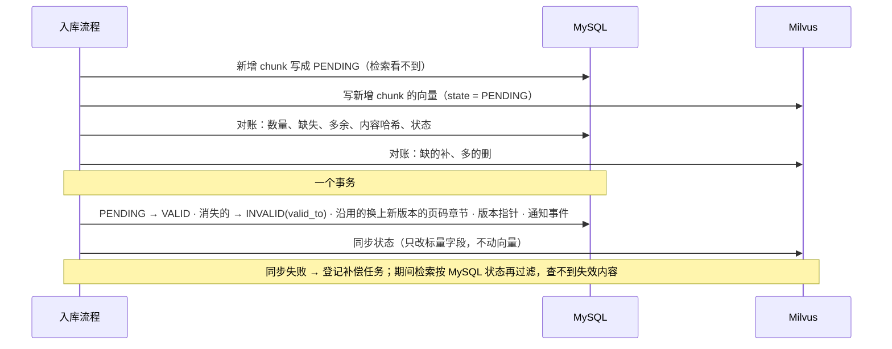

**回滚**：旧版本的 chunk 和每个版本的页码章节都还在，回滚就是把状态切回去，同样一个事务。

---

## 12.1 事务内切换

📄 [app/kbase/ingest/versioning.py:265](../assistant/app/kbase/ingest/versioning.py#L265)

```python
def _apply(cur, doc_key: str, version: str) -> dict:
    """在事务里把这份文档的切片状态切到 version：在这个版本下登记过元数据的 → VALID（换上这个版本的序号、章节、页码），
    其余原来 VALID 的 → INVALID。别的版本的暂存切片（PENDING 且 valid_from 不是 version）不动"""
    cur.execute("SELECT chunk_id, state, valid_from, metas FROM kb_chunk WHERE doc_key = %s FOR UPDATE", (doc_key,))
    on, off = [], []
    for r in cur.fetchall():
        metas = _loads(r["metas"])
        if version in metas and not (r["state"] == "PENDING" and r["valid_from"] != version):
            m = metas[version]
            cur.execute("UPDATE kb_chunk SET state = 'VALID', valid_to = NULL, version = %s, chunk_seq = %s, section = %s, page = %s, parent_id = %s "
                        "WHERE chunk_id = %s", (version, m["seq"], m["section"], m.get("page"), m["parent_id"], r["chunk_id"]))
            on.append({"chunk_id": r["chunk_id"], "version": version, "page": int(m.get("page") or 0), "section": (m["section"] or "")[:390],
                       "parent_id": m["parent_id"]})
        elif r["state"] == "VALID":
            cur.execute("UPDATE kb_chunk SET state = 'INVALID', valid_to = %s WHERE chunk_id = %s", (version, r["chunk_id"]))
            off.append(r["chunk_id"])
    return {"on": on, "off": off}
```

**注解**：每个 chunk 有一个 `metas` 字段，记「在哪个版本下序号、章节、页码是多少」。切到哪个版本，就把那个版本的元数据写到当前列上——所以沿用的 chunk 不用复制，一行数据跨多个版本。

---

## 12.2 中断了怎么办：补偿任务 + 通知

**导入中断**（重试 3 次都失败）→ 登记一个持久化的补偿任务 → 后台每分钟执行：删掉这次留下的 PENDING chunk、Milvus 向量、MinIO 原文件和独有图片。补偿本身也按 30 秒 / 2 分钟 / 10 分钟 / 30 分钟退避，用完就告警。

📄 [app/kbase/ingest/versioning.py:401](../assistant/app/kbase/ingest/versioning.py#L401)

```python
def clean_staged(doc_key: str, version: str) -> dict:
    """清理中断导入的残留：这个版本的 PENDING 切片（SQL + Milvus）、沿用切片上登记的这个版本的元数据、父章节参数图纸、MinIO 原文件和独有图片。
    版本已经生效（或曾经生效）的不清"""
    v = store.one("SELECT status FROM kb_doc_version WHERE doc_key = %s AND version = %s", (doc_key, version))
    if v and v["status"] in ("ACTIVE", "SUPERSEDED"):
        return {"skipped": f"版本状态是 {v['status']}，不清理"}
    pending = [r["chunk_id"] for r in store.query("SELECT chunk_id FROM kb_chunk WHERE doc_key = %s AND valid_from = %s AND state = 'PENDING'", (doc_key, version))]
    # Milvus 里可能有 SQL 没记上的（写完 Milvus、SQL 事务前就崩了的情况不会发生，因为先写 SQL；但写 Milvus 写到一半崩的会有）
    orphan = [i for i, st in vectors.ids_of(doc_key, ("PENDING",)).items()
              if i not in {r["chunk_id"] for r in store.query("SELECT chunk_id FROM kb_chunk WHERE doc_key = %s AND state <> 'PENDING'", (doc_key,))}]
    if pending or orphan:
        vectors.delete_ids(sorted(set(pending) | set(orphan)))
    store.execute("DELETE FROM kb_chunk WHERE doc_key = %s AND valid_from = %s AND state = 'PENDING'", (doc_key, version))
    out = purge(doc_key, version)
    return {"pending": len(pending), "milvus_orphans": len(orphan), **out}
```

**通知为什么先落库再发消息队列**：版本切换和通知事件在**同一个事务**里提交——切换成功就一定有通知，回滚了就一定没有。转发线程把事件投到 RabbitMQ，消费者渲染成邮件经 SMTP 发出，按事件号去重（重复投递也只发一封）。RabbitMQ 挂超过 5 分钟，就在本进程里直接处理积压的事件。

**每日对账**：凌晨逐份核对 MySQL 和 Milvus（数量、内容哈希、状态），能修的自动修，修不好的告警；顺带清理超过 7 天的旧版本和孤儿暂存数据。

---

## 13. 可观测：每次问答一条链路

**@observe**：给函数加上这个装饰器，调用时自动在 Langfuse 里开一个「步骤」，记输入、输出、耗时、报错；函数里再调别的带 @observe 的函数，就是嵌套的步骤。

```
知识库问答（一次请求）                    文档版本 · 提示词版本 answer@v4,rewrite_hyde@v1 · token
├── 理解问题
├── 确认主题
├── 改写和假设答案
│   └── rewrite_hyde ── 生成（提示词、输出、token）
├── 检索文档
│   └── recall
│       ├── recall·dense   命中 10 条
│       ├── recall·hyde    命中 10 条
│       └── recall·bm25    命中 10 条
├── 重排序
│   └── rerank（候选 16 条 → 留下 2 条，每条分数）
└── 生成回答 ── 生成（完整提示词、回答、token、上下文预算明细）
```

📄 [app/platform/tracing.py:175](../assistant/app/platform/tracing.py#L175)

```python
def observe(name: str | None = None, output=None, input=None):
    """output / input：把返回值、参数转成适合记录的样子（默认参数只记简单类型，返回值原样截断）"""
    def deco(fn):
        span_name = name or fn.__name__

        @functools.wraps(fn)
        def wrapper(*args, **kwargs):
            trace, parent = current()
            if trace is None or not trace.on:
                return fn(*args, **kwargs)
            span = trace.child(parent, span_name, input(*args, **kwargs) if input else _arg_view(args, kwargs))
            token = _current.set((trace, span))
            t = time.time()
            try:
                out = fn(*args, **kwargs)
            except Exception as e:
                trace.close(span, None, time.time() - t, f"{type(e).__name__}: {str(e)[:200]}")
                raise
            finally:
                _current.reset(token)
            try:
                view = output(out) if output else out
            except Exception:
                view = None
            trace.close(span, view, time.time() - t)
            return out
        return wrapper
    return deco
```

**用法**：用户点踩后，从 Bad Case 直接点开这次的链路，看是没召回到、排序错了、还是生成时理解错了。

---

## 13.1 MongoDB 查询日志 + Bad Case 池

每次问答写一条，字段一次看全：

| 字段 | 内容 |
|---|---|
| question / rewritten / hyde | 原问题、改写、假设答案 |
| route / subject | 走了哪条路、锁定了哪个型号 |
| recall | 三路融合后的候选，每条带「哪一路排第几」「RRF 分数」 |
| reranked | 精排后留下的和分数 |
| answer / citations | 回答、引用（文档号、版本、章节、页码、切片号） |
| latency_ms / tokens / prompt_version / budget | 各阶段耗时、token、提示词版本、上下文预算 |
| feedback | 用户点赞 / 点踩、原因、正确答案 |

📄 [app/kbase/query/querylog.py:37](../assistant/app/kbase/query/querylog.py#L37)

```python
def write(state: dict, answer_id: str, text: str, status: str) -> None:
    """问答结束时写一条。写失败只记日志，不影响回答"""
    try:
        plan, lock = state.get("plan") or {}, state.get("lock") or {}
        col().insert_one({
            "answer_id": answer_id, "trace_id": state.get("trace_id"), "session_id": state.get("session_id"), "username": state.get("username"),
            "scope_key": state["scope"].key() if state.get("scope") else None, "ts": datetime.now(),
            "question": state.get("question"), "rewritten": state.get("rewritten"), "hyde": state.get("hyde") or None,
            "route": plan.get("route"), "subject": {k: lock.get(k) for k in ("models", "series", "source")} if lock else None,
            "recall": [_hit(h) for h in (state.get("hits") or [])[:30]],
            "reranked": [{"chunk_id": d.get("chunk_id"), "doc_key": d.get("doc_key"), "section": d.get("section"), "score": round(float(d.get("score") or 0), 4)}
                         for d in state.get("docs") or []],
            "facts": [f.get("title") for f in state.get("facts") or []],
            "answer": text, "status": status,
            "citations": [{k: s.get(k) for k in ("index", "type", "doc_key", "version", "title", "section", "page", "chunk_id", "score")} for s in state.get("sources") or []],
            "degraded": state.get("degraded") or [], "verify_note": state.get("verify_note"), "cache_hit": bool(state.get("cache_hit")),
            "latency_ms": state.get("latency"), "tokens": state["usage"].as_dict() if state.get("usage") else None, "budget": state.get("pack"),
            "prompt_version": state.get("prompt_version"), "feedback": None})
    except Exception as e:
        logger.warning(f"[kbase] 写查询日志失败：{e}")
```

**Bad Case 闭环**：用户点踩 → 反馈回写到这条日志 → Bad Case 池从 MongoDB 筛出点踩的记录 → 每条都能看到当时的召回和引用，回溯到原始 chunk → 针对性改（补术语、调切分、改提示词）→ 改完用评测集回归。每周一自动推一份 Bad Case 周报。

---

## 13.2 评测：单变量调参

**方法**：固定一组基线配置，**每次只改一个变量**（同时改两个，指标变了不知道是谁的功劳）。变量：召回路数、每路召回条数、TopK、阈值、是否精排、chunk size。chunk size 的变体在临时集合里重新切分和向量化，不动线上数据。

**两层指标**：
- 检索指标（不调大模型，全部题目）：标准章节排第几 → 第 1 条就对的比例、前 3 条有对的比例
- RAGAS（大模型当评委，抽样）：上下文精确率、上下文召回率

**演示环境的部分结果**（155 道有标准章节的说明类题；演示库约 60 份模拟文档）：

| 配置 | 召回进候选池 | 第 1 条就对 | 前 3 条有对的 | 平均给模型几章 | 给模型的资料里有用的占比 |
|---|---|---|---|---|---|
| 基线（三路各 Top10 → 精排 → 最多 3 条） | 98.7% | 81.9% | 98.1% | 2.83 | 35.6% |
| 每路召回 50 条 | 98.7% | 81.9% | 98.1% | 2.83 | 35.6% |
| 最多留 2 条 | 98.7% | 81.9% | 97.4% | 1.99 | 49.4% |
| 最多留 5 条 | 98.7% | 81.9% | 98.1% | 4.41 | 25.0% |
| 关掉重排：三路 | 98.7% | 97.4% | 97.4% | 2.98 | 32.8% |
| 关掉重排：去掉 HyDE | 98.7% | 96.1% | 97.4% | 2.99 | 32.7% |
| 关掉重排：只用稠密 | 98.7% | 94.2% | 97.4% | 2.97 | 32.9% |
| 关掉重排：旧方案（稠密+稀疏） | 98.7% | 92.3% | 97.4% | 2.98 | 32.8% |

**怎么读**：
- 三路召回有用：关掉精排单看召回，三路比旧方案「第 1 条就对」高 5 个点，HyDE、BM25 各有贡献
- 每路 10 条和 50 条一样：候选池已经够了，没必要多召回
- 最多 3 条：比 5 条噪声少得多，又不像 2 条那样开始丢命中
- 开着精排「第 1 条就对」反而低：被换掉的都是同一份文档里另一个也相关的章节（问题要两章一起答），前 3 条命中率 98%，不是排错

---

## 14. 部署：Docker + Nginx

| 文件 | 内容 |
|---|---|
| `assistant/Dockerfile` | 服务镜像；依赖按锁文件装；torch 用 CPU 版（向量和精排在 CPU 上跑，大模型走 vLLM 服务），镜像 3.8GB；非 root 运行；健康检查 |
| `deploy/kbase/docker-compose.yml` | 知识库服务 + 入口网关；端口只绑内网地址 |
| `deploy/nginx/kbase.conf` | HTTPS（公司内部 CA）、SSE 不缓冲、按来源限流、运维接口只给运维网段、安全响应头 |
| `deploy/nginx/allowlist.conf` | 办公网、车间网、VPN 地址池、运维网段 |

📄 [deploy/nginx/kbase.conf:41](../assistant/deploy/nginx/kbase.conf#L41)

```nginx
    location /kbase-api/ask {
        limit_req zone=kb_ask burst=10 nodelay;
        proxy_pass http://kbase:8094/ask;
        proxy_http_version 1.1;
        proxy_buffering off;                                  # SSE 流式输出不能缓冲
        proxy_read_timeout 300s;
    }
```

**注解**：SSE 流式输出必须关掉 Nginx 的缓冲（`proxy_buffering off`），不然用户要等全部生成完才一次性看到；转发时用 Nginx 自己看到的来源地址**覆盖**请求头，客户端伪造的不算数。

---

## 15. 成果

**上线数据**（项目说明）：

| 指标 | 结果 |
|---|---|
| 规模 | 解析 2,000+ 份文档（30 万页），产出 70 万 chunk |
| Top5 检索命中率 | 82% → 95%+ |
| RAGAS Faithfulness（回答忠于资料） | 0.78 → 0.92 |
| RAGAS Context Precision（给模型的资料准不准） | 0.72 → 0.88 |
| RAGAS Context Recall（该给的资料给全没有） | 0.75 → 0.90 |
| RAGAS Answer Relevancy（答没答到点上） | 0.80 → 0.93 |
| 延迟 | 首 token < 1.5s，P95 < 12s |

**演示环境**：本次讲解用的代码和数据是按同样架构复现的演示环境（约 60 份模拟资料、300 多个切片，大模型用 DeepSeek 代替本地 Qwen3-32B，SSO 和金蝶连的是模拟端），评测数字见评测文档，和上线数据不是同一个量级。

---

## 16. 现场演示（10 分钟）

| 步骤 | 操作 | 看什么 |
|---|---|---|
| 1 | 登录页点「公司 SSO 登录」，选「张工（伺服研发部 P7）」 | 底部显示部门路径和「机密」 |
| 2 | 问「KL-SV-80 的额定转矩是多少？」 | 反问两个候选型号 → 点 750W → 走 SQL，1~2 秒出 2.388 N·m |
| 3 | 问「伺服电机发烫是什么原因？」 | 「理解为：…过热…」；出处里「召回：语义第 1、假设答案第 1、关键词第 1」 |
| 4 | 问「交流伺服电机的转矩-转速特性曲线怎么看？」 | 出处下面有曲线图缩略图，点开是临时签名链接 |
| 5 | 退出，换「王销（销售经理）」问同一个工艺问题 | 查不到，或明确提示「没有权限」 |
| 6 | 「资料与入库管理」上传一份改过一段的新版本 | 任务结果：新增 x、沿用 y、消失 z |
| 7 | 点踩一个回答 → 打开 Bad Case | 看到当时的召回、精排、引用 |
| 8 | 打开 Langfuse | 嵌套的步骤树、每步耗时和 token |

**命令行演示**：`scripts/kbase_selftest.py`（38 项，包括「切换前掉电、新切片检索不到、重试后切换成功、回滚」）。

---

## 17. 可能被问到的问题

**Q：为什么不直接用大模型的长上下文，把文档全塞进去？**
A：资料几十万页，塞不下；就算塞得下，成本和延迟都不可接受，而且模型在长上下文里找细节不可靠。检索把范围缩到 3 个章节，再让模型读。

**Q：为什么参数不让大模型从文档里读？**
A：向量检索分不清 750 和 400；模型会「顺手」换算或四舍五入。数值从结构化表里精确取，回答里的每个数字还要通过引用校验（必须在被引用的资料里出现过）。

**Q：Milvus 和 MySQL 不在一个事务里，怎么保证一致？**
A：MySQL 是真相源先提交；Milvus 只同步状态字段，失败登记补偿任务追上；这段时间检索结果按 MySQL 的状态再过滤一遍，所以查不到失效内容；每天还有全量对账。

**Q：HyDE 会不会把编造的内容带进回答？**
A：不会。假设答案只用来算向量去检索，不放进给模型的资料里，也不给用户看；不确定的数值要求写成 X。

**Q：精排为什么不直接用大模型打分？**
A：几十条资料逐条让 32B 模型打分，延迟和成本太高；交叉编码器（bge-reranker）专门干这个，一次几十条几秒钟，效果足够。

**Q：权限为什么要在检索「之前」过滤，不能检索完再筛？**
A：检索完再筛，TopK 里可能大半是没权限的，筛完剩不下几条，召回质量就差了；而且没权限的内容进过内存、日志，有泄露风险。先过滤再取 TopK，模型根本拿不到没权限的内容。

**Q：缓存会不会把机密的答案给了没权限的人？**
A：缓存 key 里带「权限范围」的哈希，研发和销售问同一句话是两个不同的缓存。

**Q：增量更新时，如果章节标题改了怎么算？**
A：章节标题参与指纹计算，标题改了算内容变化，那块会重新识别和向量化；只有页码、页眉页脚、文档标题、空白这类排版变化不算。

**Q：图纸解析准确率怎么保证？**
A：读矢量实体，不做 OCR；单元测试覆盖 11 种标注写法和一张专门造的 GB 测试图纸；原有图纸的解析结果和人工核对过的数据逐行比对；读不全的图渲染成图片交给 Qwen-VL 复核，再不行转人工。

**Q：远程办公怎么用？**
A：没有公网入口。用公司电脑连 VPN，拿到 VPN 地址池的地址后访问；Nginx 和应用各校验一次来源地址。
