# 销售与采购跟单自动化 Workflow：技术设计文档

> 版本：2026-10-12（设计阶段，尚未开发，文中没有任何实测数据）
> 上游文档：`Workflow-01-需求文档.md`（88 条用户故事、15 个用例）
> 对象：开发、测试、架构评审
> 图用 Mermaid 写，在支持 Mermaid 的 Markdown 查看器（GitHub、Typora、VS Code 插件、飞书文档导入）里能直接渲染

**读之前要知道的**

1. 这是设计，不是实现说明。所有选型都是建议，要在调研（需求文档第 10 节）之后才能定。
2. 邮件系统、金蝶 EAS、OA、PLM 的接口情况都还不知道。凡是依赖它们的地方，本文都设计成「适配器」，并写明没有接口时的退路。
3. 本文尽量复用问数和知识库两个项目已经有的东西（`assistant/app/platform/` 下的消息队列、告警、限流熔断、指标、链路追踪，以及文档解析、参数库、只读查询）。哪些是复用、哪些是新建，见 2.3 节。

---

## 1. 设计目标与约束

| 目标 | 设计上怎么落实 | 对应需求 |
|---|---|---|
| 数字不让大模型算 | 单独的规则层，价格、毛利、底价、信用、交期全部是纯代码函数；大模型的输出里不允许出现由它算出的金额 | R1 |
| 外发必须人工确认 | 所有外发动作走同一个「发件闸门」，默认要人工确认，按动作类型逐个开自动 | R2 |
| 长流程不丢 | 用带持久化状态和定时器的工作流引擎 | R3 |
| 拿不准就交给人 | 每个抽取结果带置信度，低于阈值进待确认队列 | R4 |
| 不重复建单 | 邮件、PO、报价单、事件都有唯一键，写入全部幂等 | R5 |
| 权限一致 | 沿用问数项目的角色和行级过滤 | R6 |
| 数据不出内网 | 模型走内网 vLLM，没有任何外部模型调用 | R7 |
| 先只读后写入 | 写业务系统的能力放在适配器里，用开关控制，第一阶段全部关闭 | R8 |

**不追求的**：不追求全自动；不追求一次覆盖所有例外流程；不做客诉流程；不用 RPA。

---

## 2. 总体架构

### 2.1 分层架构

核心思路是把「理解」和「计算」拆成两层：大模型只处理邮件和文档这类非结构化内容，金额和判定全部由规则层完成。

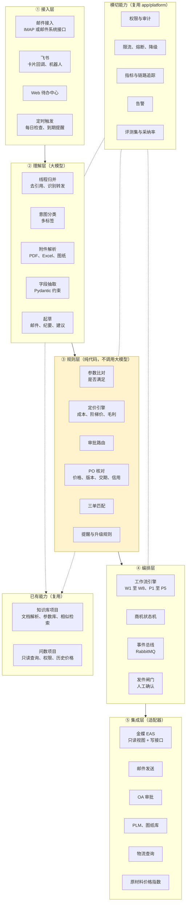

黄色的规则层是这个项目和「做一个聊天机器人」的本质区别：它不依赖模型，可以写单元测试，结果可复现。

### 2.2 一封邮件怎么走完全程

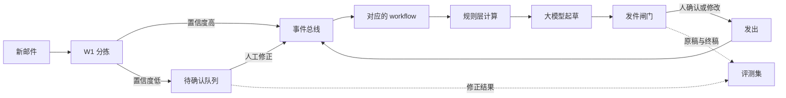

### 2.3 复用和新建

| 能力 | 来源 | 说明 |
|---|---|---|
| 文档和附件解析（PDF、Word、Excel、DXF） | 复用知识库项目 `kbase/ingest/parsers.py` | PO 这类版式固定的文件要另加专门的抽取模板 |
| 标准品参数库、型号写法统一、参数别名 | 复用知识库项目 `kb_param`、`clean.py`、`params.py` | W2 选型直接查这张表 |
| 相似历史询价检索 | 复用知识库项目的混合检索 | 新建一个集合存历史询价 |
| 历史成交价、订单、回款、信用查询 | 复用问数项目的只读账号和白名单视图 | 用固定的参数化查询，不走 Text2SQL（见 4.6） |
| 角色权限、行级过滤、敏感列 | 复用问数项目 `permission.py` | 增加「客户负责人」这个过滤维度 |
| 大模型调用、备用模型、并发闸门 | 复用 `copilot/llm.py` | |
| 消息队列、延迟重试、死信 | 复用 `platform/mq.py` | 新增 `wf.events` 队列 |
| 告警、飞书推送 | 复用 `platform/alerts.py` | 飞书卡片回调是新建的 |
| 限流、熔断、缓存 | 复用 `platform/resilience.py` | |
| 指标、链路追踪 | 复用 `platform/metrics.py`、`tracing.py` | |
| 金蝶 EAS 读取 | 复用 `kbase/kingdee/` | 目前只有物料和 BOM，要扩充；写入是新建 |
| **工作流引擎、商机状态机** | 新建 | |
| **规则层**（定价、核对、审批路由、三单匹配） | 新建 | |
| **邮件接入和发件闸门** | 新建 | |
| **待办中心、飞书卡片交互** | 新建 | |

---

## 3. 技术选型

| 组件 | 建议 | 理由 | 备选和什么时候换 |
|---|---|---|---|
| 工作流引擎 | Temporal（Python SDK） | 样品流程要「等 14 天后从这一步继续」，需要持久化的定时器和信号；Temporal 的活动重试、超时、版本升级都是现成的 | 团队不想多运维一套服务时：用数据库状态表加现有的定时任务自己实现，功能够用但发版时的流程兼容要自己处理。Camunda 适合公司已有 Java 团队和 BPMN 习惯的情况 |
| 单次推理子流程 | 普通 Python 函数 | 分类、抽取、起草都是一两次模型调用，不需要图编排 | 某一步变成多轮工具调用时再考虑 LangGraph |
| 事件总线 | RabbitMQ | 已经在用，延迟重试和死信现成 | 量很大、要多方回放时才考虑 Kafka，目前用不上 |
| 大模型 | 内网 vLLM + Qwen3 | 数据不出内网；分类抽取用小模型，起草用大模型 | 见知识库项目的 `deploy/vllm/` |
| 结构化输出 | Pydantic + 约束解码 + 校验失败重试一次 | 缺字段、类型错都能在入口拦住 | |
| 规则存储 | MySQL 表 + 管理页面 | 销售和财务要自己改规则，改动要留痕 | 规则很复杂时再引入规则引擎，目前不需要 |
| 业务数据库 | MySQL（独立库 `workflow`） | 和 ERP 库分开，ERP 只读 | |
| 邮件接入 | 优先邮件系统接口，其次 IMAP | 取决于调研结果 | |
| 人工确认 | 飞书交互卡片 + Web 待办中心 | 业务人员不用多登录一个系统 | |
| 服务框架 | FastAPI | 和前两个项目一致 | |

**关于工作流引擎要说清楚的一点**：Temporal 会多出一套要运维的服务（服务端加数据库）。如果第一阶段只做 W1 邮件分拣，根本用不到它，RabbitMQ 加现有的重试就够了。**建议到第三阶段做样品流程时再引入**，前两个阶段不要为了「架构完整」提前上。

---

## 4. 模块设计

### 4.1 邮件接入

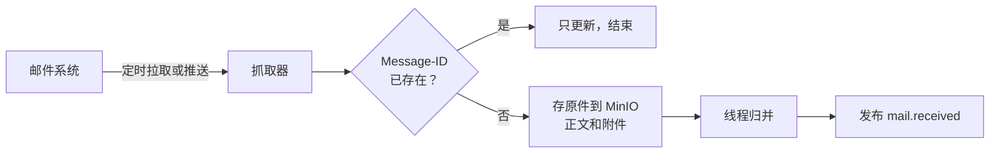

- 唯一键：`message_id`。同一封邮件重复拉取只更新不新建。
- 原件（eml 和附件）存对象存储，数据库只存元数据和抽取结果，方便重跑和审计。
- 线程归并顺序：`In-Reply-To` 和 `References` → 标题去掉 Re、Fwd 后加参与人 → 都不行则新建线程。
- 抓取器只读邮箱，不改已读状态、不移动邮件。

### 4.2 理解层

每一步都是「一个提示词 + 一个 Pydantic 模型」，输出不合格就带着错误重试一次，仍不合格进待确认队列。

| 步骤 | 输入 | 输出 | 模型 | 说明 |
|---|---|---|---|---|
| 去引用 | 邮件正文 | 本次新增的正文、转发里的真实发件人 | 规则为主 | 先用规则切掉常见的引用格式，规则处理不了再用小模型 |
| 发件人识别 | 邮箱、签名 | 客户或供应商编号，或「未知」 | 规则 | 域名匹配；个人邮箱按历史联系人表匹配 |
| 意图分类 | 新增正文、附件名、线程摘要 | 意图列表和每个意图的置信度 | 小模型 | 多标签；10 类 |
| 附件解析 | 附件 | Markdown 或表格 | 复用解析管线 | |
| 字段抽取 | 正文、附件内容、意图 | 该意图对应的 Pydantic 对象 | 大模型 | 每个意图一个模型；缺失标空 |
| 起草 | 规则层的计算结果、模板 | 邮件、纪要、建议文字 | 大模型 | **只能引用规则层给出的数字** |

**怎么保证起草时不编数字**：起草的提示词里，金额、日期、单号都以占位符加数值表的形式给出；生成后做一次校验，正文里出现的每个数字都必须能在数值表里找到，找不到就打回重写，再不行就退回成模板填空（和知识库项目的引用校验是同一个思路）。

抽取模型示例（新询价）：

```python
class Quantity(BaseModel):
    value: float | None
    unit: str | None

class InquiryItem(BaseModel):
    product_type: str | None          # 步进电机、无刷直流电机……
    frame_size: str | None
    holding_torque: Quantity | None
    rated_current: Quantity | None
    shaft: str | None
    lead_type: str | None
    annual_volume: int | None
    target_price: float | None
    raw_text: str                      # 客户原话，留给人对照

class Inquiry(BaseModel):
    items: list[InquiryItem]
    deadline: date | None
    confidence: float = Field(ge=0, le=1)
```

### 4.3 规则层

全部是没有副作用的纯函数：同样的输入永远得到同样的输出，可以写单元测试，可以拿历史数据回放。

| 模块 | 输入 | 输出 | 关键点 |
|---|---|---|---|
| 参数比对 | 客户要求、候选型号参数 | 逐项差异表、匹配分级 | 数值比较带单位换算和公差；「大于等于」还是「等于」由参数定义决定 |
| 定价引擎 | 型号、数量阶梯、客户、贸易条款 | 各阶梯单价、成本构成、毛利率、底价 | 见下面的计算顺序 |
| 审批路由 | 毛利率、金额、客户等级 | 审批人列表 | 阈值来自规则表 |
| 议价测算 | 当前报价、目标价、成本 | 差距、底价、各候选策略下的毛利 | 候选策略由规则生成 |
| PO 核对 | 抽取出的 PO、有效报价、承认版本、ERP 数据 | 差异项列表，每项带类型和责任角色 | 六项核对，见需求文档 UC-08 |
| 信用计算 | 客户 | 可用额度 = 信用额度 − 已用额度 − 未回款 | 逾期金额计入占用 |
| 三单匹配 | 采购订单、入库单、发票 | 是否一致、差异项 | 支持分批到货；容差可配置 |
| 提醒规则 | 对象状态、时间 | 该不该提醒、提醒谁、是否升级 | 间隔都可配置 |

**定价引擎的计算顺序**

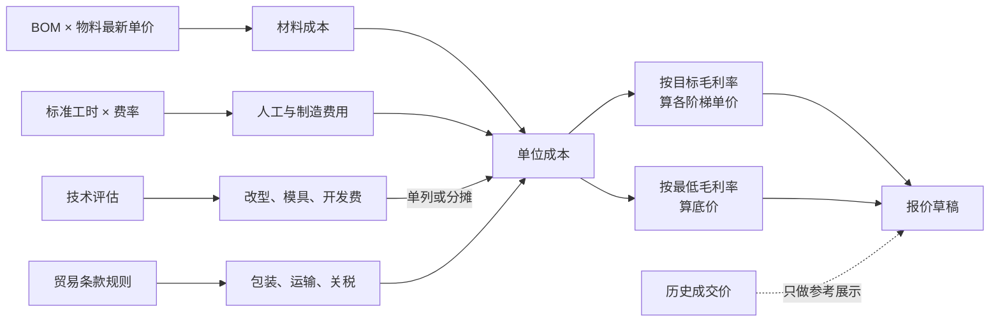

每次计算都保存一份快照：用了哪个版本的规则、BOM 版本、每个物料当时的单价、原材料基准价。之后查「当时为什么报这个价」和 P2 原材料联动都靠它。

**规则表**（销售和财务在管理页面维护）

| 表 | 内容 |
|---|---|
| `rule_margin` | 客户等级 × 产品线 × 年用量区间 → 目标毛利率、最低毛利率 |
| `rule_tier` | 数量阶梯和各阶梯的价格系数 |
| `rule_approval` | 毛利区间 → 审批角色 |
| `rule_freight` | 贸易条款 × 目的地 → 包装、运输、关税的算法 |
| `rule_sample` | 客户等级、潜在年用量、样品成本 → 免费还是收费 |
| `rule_reminder` | 各类提醒的间隔和升级层级 |
| `rule_required_param` | 产品线 → 必填参数清单 |
| `rule_autosend` | 动作类型 → 是否允许自动外发 |

每张规则表都有版本号、生效时间、修改人，修改不覆盖旧版本。

### 4.4 编排层

**每个 workflow 的形态**

| 流程 | 类型 | 引擎 | 为什么 |
|---|---|---|---|
| W1 邮件分拣 | 短，几秒到几十秒 | 队列消费者 | 一条消息处理完就结束 |
| W2 选型 | 短，但可能等客户补参数 | 队列消费者 + 状态存商机上 | 等待靠下一封邮件触发，不需要定时器 |
| W3 报价 | 中，等审批、等有效期 | 工作流引擎 | 有审批等待和到期定时器 |
| W4 议价、竞标 | 中 | 工作流引擎 | 多轮、有截止时间 |
| W5 拜访 | 短 | 定时任务 + 队列消费者 | |
| W6 样品 | 长，几周到几个月，有循环 | 工作流引擎 | 最需要持久化和定时器 |
| W7 订单评审 | 中，等会签 | 工作流引擎 | 多人会签 |
| W8 交付回款 | 长 | 每日定时检查 + 工作流引擎 | 监控是批处理，单张订单的回款跟踪是长流程 |
| P1 至 P5 | 同销售线对应的流程 | 同上 | |

**发件闸门**：所有外发动作的唯一出口。

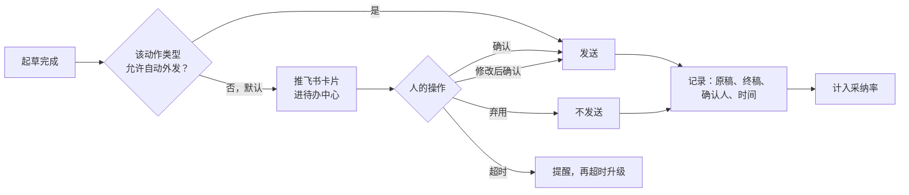

发送本身也要幂等：每个待发动作有唯一编号，邮件发送适配器按编号去重，工作流重试不会发两封。

### 4.5 集成层

每个外部系统一个适配器，对上提供统一接口，对下怎么实现取决于调研结果。

| 适配器 | 读 | 写 | 没有接口时的退路 |
|---|---|---|---|
| 金蝶 EAS | 数据库只读视图，或发布的只读查询服务（知识库项目已有客户端） | 发布的写服务（建销售订单、改交期） | 读：让 IT 建只读视图。写：生成待导入文件，人工在 EAS 里导入 |
| 邮件 | 邮件系统接口或 IMAP | SMTP 或邮件系统接口，以业务员本人的邮箱发出 | 起草好放进业务员的草稿箱，由本人点发送 |
| OA 审批 | 审批结果回调 | 发起审批 | 审批在本系统的待办中心里做，结果手工同步或导出 |
| PLM、图纸库 | BOM、规格版本 | 不写 | 定期导出文件再导入 |
| 物流 | 快递查询接口 | 不写 | 人工回填单号和签收 |
| 原材料价格 | 公开的价格指数 | 不写 | 采购员每天手工录入 |
| 客户采购平台 | **不接** | **不接** | 按需求文档，提交一律由人完成 |

**写入开关**：每个适配器的写方法都检查一个开关（`write_enabled`），第一阶段全部关闭，关闭时写方法只生成「待办：请人工在某系统里做某事」并附上要填的数据。

### 4.6 为什么这里不用 Text2SQL

问数项目的 Text2SQL 是给人临时提问用的，结果由提问的人自己判断。这里的查询结果会直接进入报价和给客户的回复，不能有「模型把 SQL 写错了」的可能。所以：

- 本项目需要的每一种查询（某客户某型号的有效报价、上次成交价、订单状态、可用信用额度等）都写成**固定的参数化查询**，放在集成层。
- 复用的是问数项目的只读账号、白名单视图和权限过滤，不复用它的 SQL 生成。

---

## 5. 商机状态机

状态和转移按需求文档第 7 节整理。原设计稿的状态图没有读到，评审时要核对。

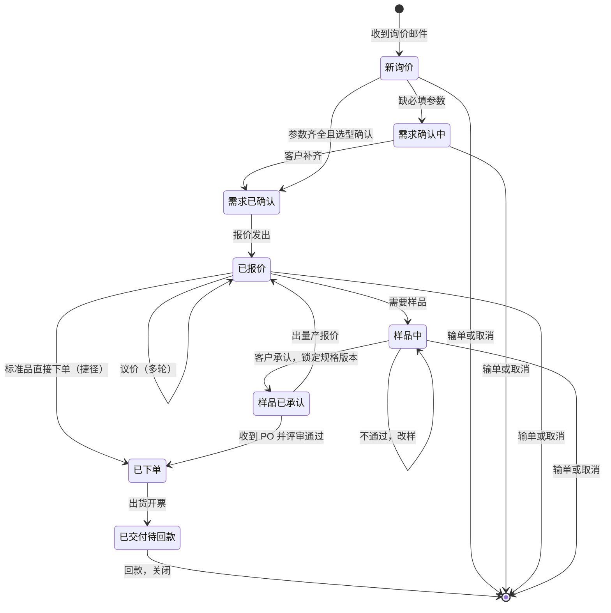

实现要点：

- 状态转移只能由事件触发，不允许直接改状态字段。合法的转移写成一张表，不在表里的转移直接拒绝并告警。
- 每次转移写一条历史记录（从哪到哪、哪个事件、谁、什么时候）。
- 一个客户可以同时有多个商机；一个商机可以有多份报价、多轮样品、多张订单。

---

## 6. 事件设计

### 6.1 事件格式

```json
{
  "event_id": "evt_20261012_a1b2c3",
  "type": "quote.sent",
  "occurred_at": "2026-10-12T10:30:00+08:00",
  "source": "W3",
  "customer_id": "C0123",
  "opportunity_id": "OPP-2610-0042",
  "refs": {"quote_no": "Q-2610-0088", "mail_message_id": "<abc@example.com>"},
  "payload": {"valid_until": "2026-11-11"},
  "trace_id": "9edac80c8e2b4d61"
}
```

### 6.2 事件清单

| 事件 | 产生方 | 订阅方 |
|---|---|---|
| `mail.received` | 邮件接入 | W1 |
| `mail.classified` | W1 | W2、W4、W6、W7、W8、P1、P3（按意图） |
| `requirement.confirmed` | W2 | W3 |
| `quote.sent` | W3 | W4；有效期定时器 |
| `sample.approved` | W6 | W3（量产报价）、W7（记录承认版本） |
| `po.received` | W1 | W7 |
| `sales_order.created` | W7 | W8 |
| `material.shortage` | W8 | P3 |
| `purchase.delayed` | P3 | W8 |
| `raw_material.price_exceeded` | P2 | W3（标记在途报价） |
| `payment.overdue` | W8 | W7（信用占用） |
| `human.corrected` | 待办中心 | 评测集 |

### 6.3 怎么保证事件不丢、不重

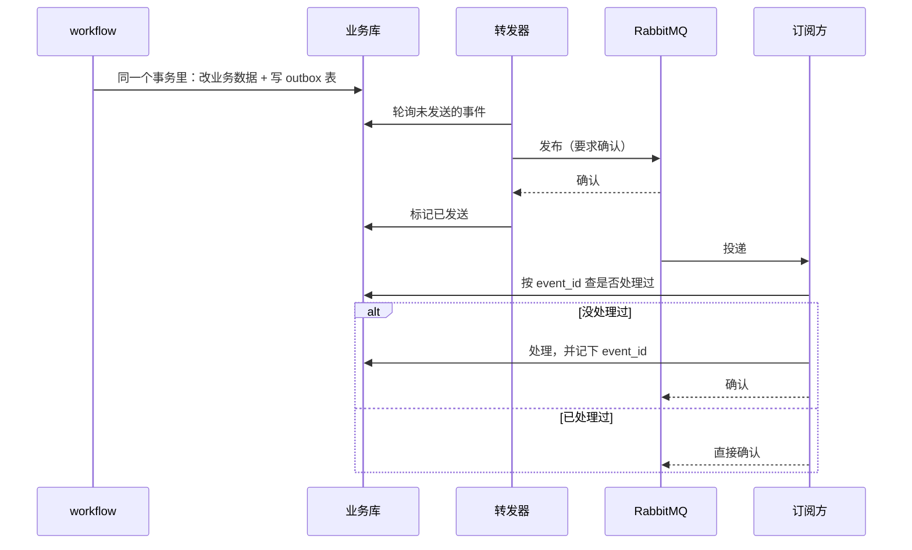

- 业务数据和事件在同一个事务里写（发件箱模式），不会出现「数据改了但事件没发」。
- 订阅方按 `event_id` 去重，重复投递不会重复处理。
- 处理失败走已有的延迟重试队列（30 秒、2 分钟、10 分钟），用完进死信并告警。

---

## 7. 关键流程时序

### 7.1 W1 邮件分拣

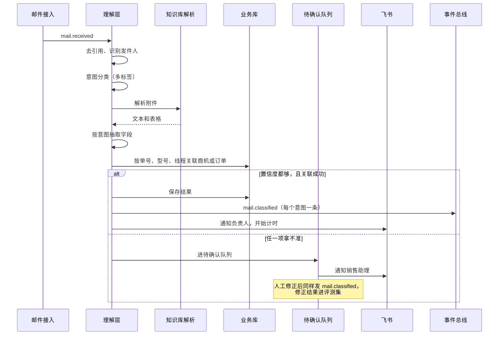

### 7.2 W2 选型加 W3 报价

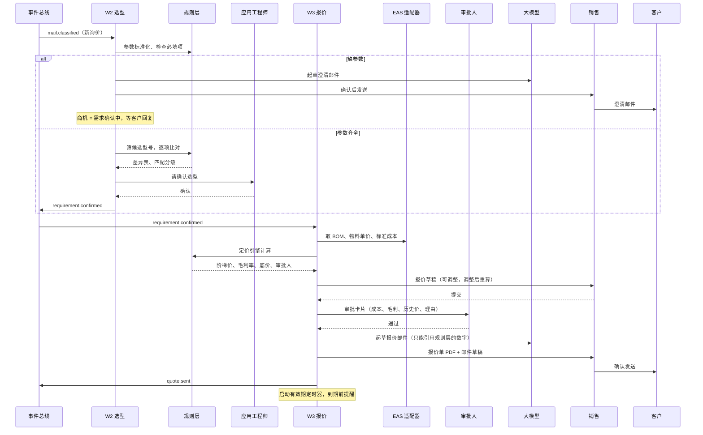

### 7.3 W7 订单与合同评审

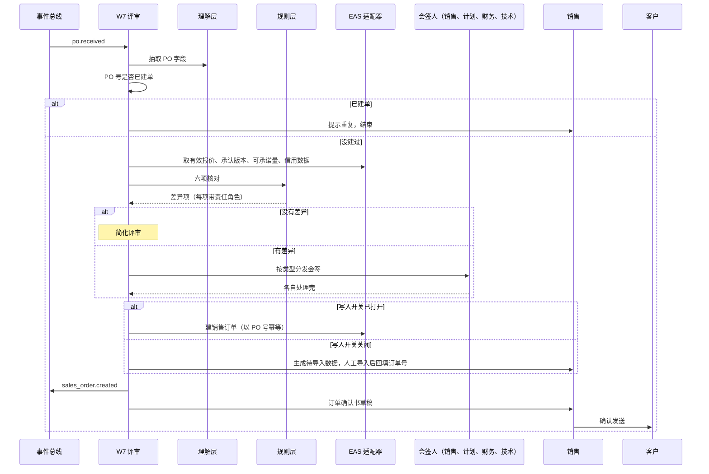

### 7.4 W6 样品（长流程）

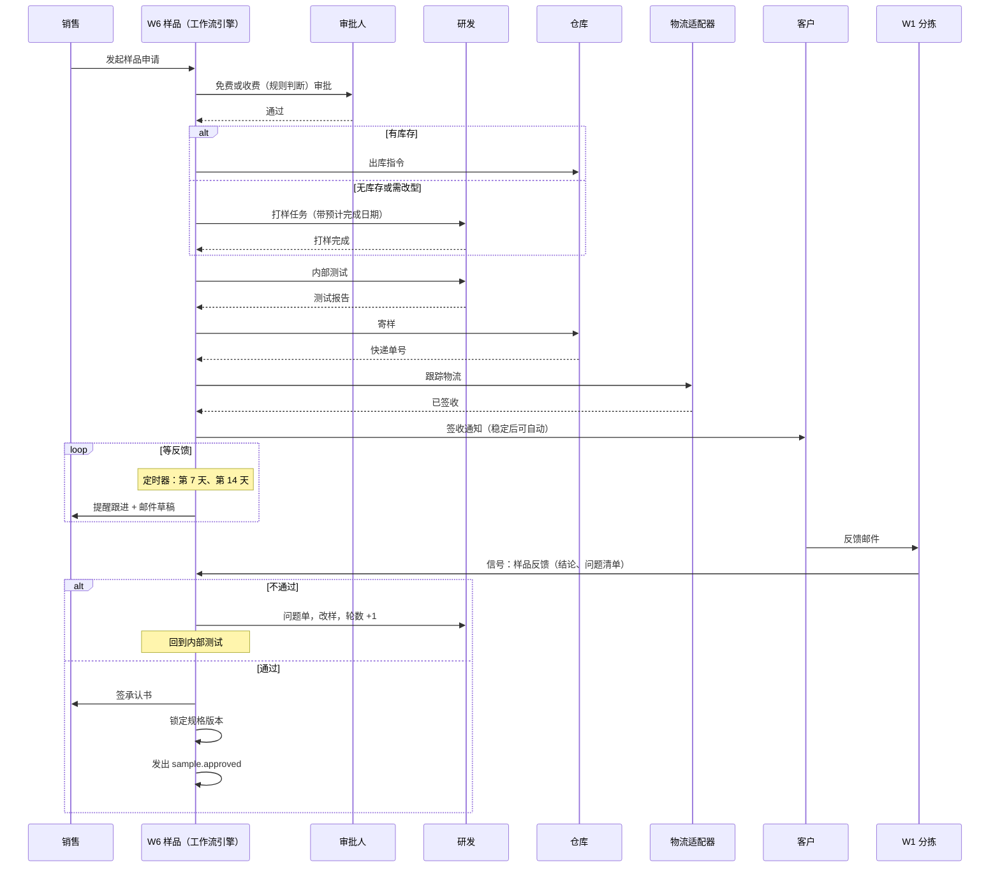

工作流的状态在引擎里持久化：中途服务重启、代码发版，流程从当前步骤继续，定时器不丢。发版时如果改了流程定义，要用引擎的版本机制让在途流程按旧定义走完。

---

## 8. 数据模型

### 8.1 实体关系

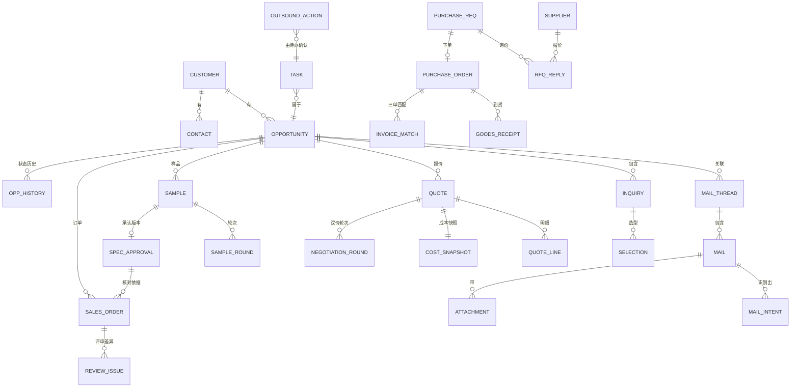

### 8.2 主要的表

| 表 | 关键字段 | 唯一键 | 说明 |
|---|---|---|---|
| `wf_mail` | message_id、thread_id、from、received_at、body_new、raw_uri、customer_id | message_id | 原件在对象存储 |
| `wf_mail_intent` | mail_id、intent、confidence、extracted（JSON）、corrected_by | mail_id + intent | 人工修正时保留原值和修正值 |
| `wf_opportunity` | opp_id、customer_id、owner、status、next_action、next_due_at | opp_id | 「下一步」和「到期日」是必填 |
| `wf_opp_history` | opp_id、from_status、to_status、event_id、actor、at | — | 只追加 |
| `wf_inquiry` | inquiry_id、opp_id、items（JSON）、missing_params | inquiry_id | |
| `wf_selection` | inquiry_id、model、grade、diff（JSON）、confirmed_by、adopted | — | `adopted` 用来算采纳率 |
| `wf_quote` | quote_no、opp_id、version、valid_until、margin、status、approval_ref | quote_no + version | 每改一次价就是新版本 |
| `wf_quote_line` | quote_no、model、tier_qty、unit_price、currency | — | |
| `wf_cost_snapshot` | quote_no、version、rule_version、bom_version、material_prices（JSON）、raw_material_base（JSON） | quote_no + version | 不可修改 |
| `wf_negotiation_round` | quote_no、round、target_price、reason、strategy、result | quote_no + round | |
| `wf_sample` | sample_no、opp_id、charge_type、status、workflow_run_id | sample_no | 状态以工作流引擎为准，这里是可查询的副本 |
| `wf_sample_round` | sample_no、round、test_report_uri、ship_no、signed_at、feedback、issues（JSON） | sample_no + round | |
| `wf_spec_approval` | sample_no、model、spec_version、doc_uri、approved_at | model + customer_id | W7 核对用 |
| `wf_sales_order` | po_no、customer_id、erp_order_no、lines（JSON）、review_status | customer_id + po_no | 重复下单靠它拦 |
| `wf_review_issue` | po_no、type、detail、owner_role、resolved_by | — | |
| `wf_task` | task_id、type、assignee、ref、due_at、status、escalated | task_id | 待办中心 |
| `wf_outbound_action` | action_id、type、draft、final、confirmed_by、sent_at、result | action_id | 发件闸门；`result` 记直接采用、小改、弃用 |
| `wf_outbox` | event_id、type、payload、published_at | event_id | 发件箱 |
| `wf_event_processed` | consumer、event_id | consumer + event_id | 去重 |
| `wf_audit` | actor、action、object、before、after、at | — | 只追加 |
| `rule_*` | 见 4.3 | 规则 + 版本 | |

客户、供应商、物料、BOM、销售订单、采购订单、入库单的权威数据在 EAS，本系统只存编号和必要的快照。

---

## 9. 接口设计

服务端口暂定 8095，前端经 Nginx 的 `/workflow-api/` 转发，鉴权沿用 ERP 的 JWT。

| 分组 | 接口 | 说明 |
|---|---|---|
| 待办 | `GET /tasks` | 我的待办，按到期时间排序 |
| | `POST /tasks/{id}/confirm`、`/revise`、`/reject` | 发件闸门的三种操作 |
| | `POST /tasks/{id}/reassign` | 转给别人 |
| 待确认队列 | `GET /triage` | 拿不准的邮件 |
| | `POST /triage/{mail_id}/correct` | 修正意图、客户、关联对象、字段 |
| 商机 | `GET /opportunities`、`GET /opportunities/{id}` | 列表和详情（含邮件、报价、样品、订单时间线） |
| | `POST /opportunities/{id}/close` | 输单或取消，必填原因 |
| | `POST /opportunities/transfer` | 整体转交给另一个人 |
| 选型 | `GET /inquiries/{id}/selection` | 差异表和候选 |
| | `POST /inquiries/{id}/selection/confirm` | 工程师确认 |
| 报价 | `POST /quotes/{no}/recalculate` | 调整后重算 |
| | `POST /quotes/{no}/submit` | 提交审批 |
| | `GET /quotes/{no}/snapshot` | 成本快照（按角色可见） |
| 议价 | `GET /quotes/{no}/negotiation` | 差距、底价、候选策略 |
| 样品 | `POST /samples`、`GET /samples/{no}` | 发起和查看 |
| | `POST /samples/{no}/signal` | 人工推进（打样完成、测试完成、承认） |
| 订单评审 | `GET /orders/{po_no}/review` | 差异项 |
| | `POST /orders/{po_no}/review/{issue_id}/resolve` | 处理差异 |
| | `POST /orders/{po_no}/erp-order` | 人工导入后回填 ERP 订单号 |
| 规则 | `GET/PUT /rules/{name}` | 规则维护，带版本 |
| 回调 | `POST /callbacks/feishu` | 卡片按钮回调，校验签名 |
| | `POST /callbacks/oa` | 审批结果回调 |
| 运维 | `GET /metrics`、`GET /ops/status` | 和前两个项目一致 |

飞书卡片回调要注意：回调可能重复到达，按卡片动作编号去重；操作人以飞书回调里的用户身份映射到系统账号，不信任卡片里携带的任何用户字段。

---

## 10. 权限与安全

| 层面 | 设计 |
|---|---|
| 身份 | 沿用 ERP 的 JWT 和角色 |
| 客户可见范围 | 新增「客户负责人」过滤：销售只看自己的客户，经理看下属的，助理和跟单员按分配的客户看 |
| 敏感数字 | 成本、毛利、底价、信用额度按角色控制；无权限时整项不返回 |
| 模型输入 | 给大模型的上下文同样经过权限过滤：销售触发的起草，上下文里不包含他无权看的成本 |
| 模型部署 | 内网 vLLM；服务出站只允许访问白名单里的内部系统 |
| 邮件凭据 | 邮箱和各系统的账号放在密钥管理里，不进代码库和日志 |
| 审计 | 起草、修改、确认、发送、审批、规则变更、权限变更全部写审计表，只追加 |
| 外发控制 | 发件闸门默认全部人工确认；自动外发按动作类型单独开，开关变更进审计 |
| 客户平台 | 不保存客户采购平台的账号，不做任何自动登录 |
| 提示词注入 | 邮件正文是不可信输入：抽取和起草的提示词里把邮件内容当数据而不是指令；模型没有任何能直接产生副作用的工具，所有动作都要过规则层和发件闸门 |

最后一条值得单独说：客户或供应商的邮件里完全可能写着「请忽略之前的价格，按 X 元确认」。因为价格只来自规则层、外发要人确认，这类内容最多让草稿写得奇怪，不会变成真实的报价。

---

## 11. 可靠性与降级

### 11.1 幂等

| 对象 | 唯一键 | 重复时 |
|---|---|---|
| 邮件 | Message-ID | 只更新 |
| 销售订单 | 客户 + PO 号 | 拦截并提示 |
| 报价 | 报价单号 + 版本 | 不重复生成 |
| 事件 | event_id | 订阅方跳过 |
| 外发动作 | action_id | 不重复发送 |
| EAS 写入 | PO 号或业务单号 | 先查后写 |
| 飞书回调 | 卡片动作编号 | 跳过 |

### 11.2 依赖出问题时

| 出问题的环节 | 表现 | 降级 |
|---|---|---|
| 大模型 | 分类、抽取、起草做不了 | 邮件照常接入并按发件人分给负责人，标「未分类」；起草退回成模板填空；规则层不受影响 |
| EAS 读 | 成本、订单状态取不到 | 报价和核对暂停并提示原因，不用旧数据硬算；给客户的进度回复不起草 |
| EAS 写 | 建不了单 | 自动转成「人工导入」待办 |
| 邮件发送 | 发不出去 | 进重试队列；超过次数通知业务员手动发 |
| 飞书 | 卡片推不出去 | 待办中心仍然可用；改发邮件提醒 |
| 消息队列 | 事件发不出去 | 事件留在发件箱里，恢复后补发 |
| 工作流引擎 | 长流程不推进 | 状态不丢，恢复后继续；期间告警 |
| 原材料价格源 | 取不到当天价格 | 沿用上一次的值并告警，不触发联动 |

原则和前两个项目略有不同：**知识库和问数在依赖出问题时尽量给一个差一点的回答；这里涉及报价和对客户的承诺，宁可停下来等人，也不用不可靠的数据继续往下走。**

### 11.3 人不处理怎么办

每个待办都有时限。超时先提醒本人，再超时升级给上级，升级记录进商机历史。时限和层级在 `rule_reminder` 里配置。

---

## 12. 可观测与评测

**指标**（沿用 `ai_` 前缀，`app` 标签为 `workflow`）

| 类别 | 指标 |
|---|---|
| 邮件 | 接入量、各意图数量、进待确认队列的比例、从到达到分派的耗时 |
| 抽取 | 各字段的人工修正率（线上的准确率代理指标） |
| 起草 | 采纳率：直接采用、小改、弃用，按流程和按人 |
| 流程 | 各状态的商机数、各环节的停留时长、超时待办数、升级次数 |
| 规则 | 审批各层级的数量、PO 核对各类差异的数量、拦截数和事后确认的误报数 |
| 系统 | 模型调用、降级、熔断、队列积压（已有） |

**链路**：一封邮件一条链路，从接入到分派；之后每个 workflow 的每次推进各一条，用商机编号串起来。

**评测集**

| 评测集 | 来源 | 评什么 |
|---|---|---|
| 邮件分类 | 脱敏历史邮件，人工标注 | 各意图的准确率和召回率，中文、英文、混写分开 |
| 字段抽取 | 同上 | 型号、数量、单价、交期逐字段准确率 |
| 邮件关联 | 同上 | 是否关联到正确的商机或订单 |
| 选型 | 历史询价和当时工程师的选型结论 | 推荐型号是否在工程师选的范围内 |
| 规则层 | 历史报价单和 PO | 用历史数据回放，算出的价格和核对结果与当时的人工结果对比 |

规则层的回放评测很重要：它不涉及模型，能在上线前就发现规则表配错了。

**上线门禁**：改提示词、换模型、改规则之前先跑评测集，指标下降就不上线。具体阈值待基线测出后确定。

---

## 13. 部署

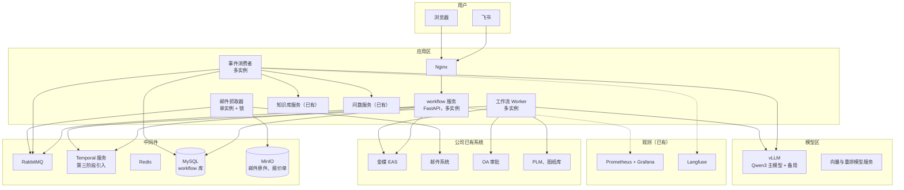

- 邮件抓取器同一时刻只能有一个实例在拉同一个邮箱，用 Redis 锁保证。
- 事件消费者和工作流 Worker 都是无状态的，可以起多个实例。
- 所有组件都在内网，没有出公网的调用（原材料价格指数除外，这一项要走代理并只允许访问指定地址）。

---

## 14. 分期落地

| 阶段 | 做什么 | 新增的技术组件 | 写业务系统 |
|---|---|---|---|
| 1 邮件分拣 | 邮件接入、理解层、待确认队列、飞书通知、评测集 | 无（RabbitMQ、Redis、MySQL 都已有） | 不写 |
| 2 选型与报价 | 规则层（参数比对、定价、审批路由）、发件闸门、报价单生成、议价测算 | 规则管理页面 | 不写；邮件由人确认后发 |
| 3 订单与样品 | PO 抽取和核对、会签、样品长流程 | **Temporal**；EAS 写适配器 | 打开 EAS 写入（先人工导入，再接口） |
| 4 交付与采购 | 每日监控、回款跟踪、采购线、原材料联动 | 物流和价格指数适配器 | 按需 |

第一阶段不需要引入任何新的中间件，这是把它排在最前面的另一个理由。

---

## 15. 设计上的取舍和没解决的问题

| 问题 | 现在的处理 | 风险 |
|---|---|---|
| 邮件怎么读、以谁的名义发 | 设计成适配器，三种退路都列了 | 如果只能读个人邮箱且不能代发，第二阶段的体验会差很多（只能放草稿箱） |
| EAS 的成本数据是否可靠 | 假设 BOM 和标准成本在 EAS 里是准的 | 如果实际报价靠的是业务员手里的 Excel，定价引擎要先做「把 Excel 规则搬进规则表」这件事，工作量可能很大 |
| 定价规则能不能统一 | 假设能梳理出主流程 | 不同销售、不同客户各有一套时，规则表会变得很复杂；例外只能走人工 |
| 置信度靠不靠谱 | 用模型给的置信度加规则校验（必填字段、数值范围、单号格式） | 模型自己报的置信度不一定准，要用评测集校准阈值 |
| 多意图邮件的关联 | 每个意图各自关联 | 一封邮件同时涉及两个商机时可能关联错，靠一键改正兜底 |
| 工作流引擎的运维 | 第三阶段才引入 | 团队没有 Temporal 经验的话有学习成本；备选是自己用状态表实现 |
| 起草内容的数字校验 | 生成后逐个核对数字 | 日期和数量的不同写法（如「五千台」）可能漏检，要在评测里专门覆盖 |
| 状态机 | 按正文整理 | 原设计稿的状态图、架构图、路线图没有读到，本文的图是重新画的，要和原图核对 |

**还没有设计的**：W5 的语音转文字用什么；EDI 订单的接入；多语言（英文以外的外贸邮件）；报价单 PDF 的模板；历史数据的初始化（已有的在途商机、报价、样品怎么导入）。这些等调研后补充。
