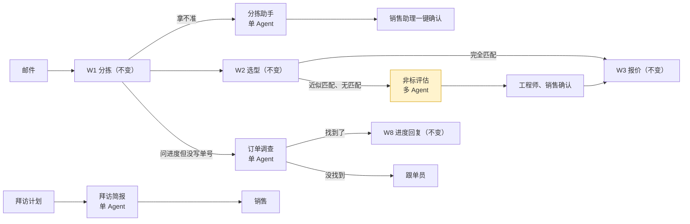
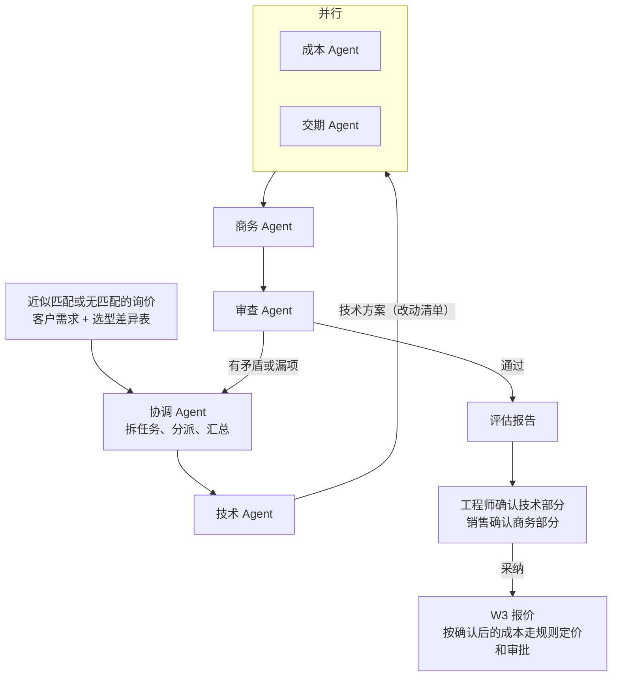

# 跟单 Workflow：Agent 补充设计

> 版本：2026-10-15（设计阶段，尚未开发）
> 上游：`Workflow-02-技术设计文档.md`、`Workflow-03-实现说明.md`
> 一句话：**确定的流程继续用状态机和规则；事先不知道要查什么的环节交给 Agent，其中非标评估用多 Agent 协作。** Agent 全部只读，结论由人确认后才进入流程。

---

## 1. 放在哪里

现有流程里有四个出口原来是「直接转给人」，改成先由 Agent 查清楚、给出建议，再转给人。骨架（状态机、规则层、发件闸门、事件）不动。



| Agent | 类型 | 触发 | 产出 | 谁确认 |
|---|---|---|---|---|
| 非标评估 | 多 Agent | 选型结果是近似匹配或无匹配 | 评估报告：推荐方案、改动项、成本估算、交期估算、报价区间、风险 | 工程师确认技术方案，销售确认后进入报价 |
| 分拣助手 | 单 Agent | 邮件进待确认队列 | 建议的客户、意图、关联商机，每条附理由和证据 | 销售助理 |
| 订单调查 | 单 Agent | 客户问进度但没写单号 | 最可能的订单和依据 | 有把握时直接走进度回复（回复本身仍要人确认），否则转跟单员 |
| 拜访简报 | 单 Agent | 拜访前一天 | 客户简报 | 销售 |

## 2. 为什么非标评估用多 Agent，其他用单 Agent

| 判断标准 | 非标评估 | 其他三个 |
|---|---|---|
| 涉及几个专业 | 技术、成本、交期、商务四个，各有自己的数据和判断方法 | 一个 |
| 能不能并行 | 能，四条线互不依赖 | 基本是顺着查 |
| 权限是否不同 | 不同：成本明细只有财务和管理层能看，技术不需要看 | 相同 |
| 结论之间要不要互相校对 | 要：技术方案改了材料，成本就得跟着变 | 不需要 |

后三个用多 Agent 只会增加调用次数和出错环节，没有收益。

## 3. 非标评估的设计

### 3.1 结构



技术方案是成本和交期的输入，所以技术先做，成本和交期再并行。这一点和「四个 Agent 同时开工」的常见画法不一样：成本要知道改哪些料才能算，硬并行只会算错。

### 3.2 各个 Agent

| Agent | 职责 | 能用的工具（全部只读） | 不能做的 |
|---|---|---|---|
| 协调 | 理解需求，决定要不要请哪个 Agent、要不要返工，汇总报告 | 调用其他 Agent | 不直接查业务数据 |
| 技术 | 找最接近的基础型号，列出要改的地方（换料、改尺寸、改绕组等），判断可行性和技术风险 | 查产品参数、按参数找相似型号、检索知识库文档（规格书、工艺规程、图纸）、查历史工程变更、查在研项目 | 不估成本、不承诺交期 |
| 成本 | 估算改型后的单位成本，列出模具费和开发费 | 查基础型号的 BOM 和成本、**按改动清单重算成本**、按改动类型查一次性费用规则 | 不定价；所有金额由工具计算 |
| 交期 | 估算打样周期、量产爬坡、首批交期 | 查产线产能和负荷、查关键物料的历史采购周期、查历史新品项目各阶段用时 | 不做排产 |
| 商务 | 按定价规则给出报价区间和审批层级，参考同类成交价 | 定价规则（复用规则层）、历史成交价、客户等级和信用 | 不改规则、不报出低于底价的价格 |
| 审查 | 检查各部分是否自洽、证据是否充分，列出需要人特别注意的地方 | 读其他 Agent 的结论和证据 | 不自己补结论，只能打回 |

**审查要查的几类问题**（写成清单，不靠模型自由发挥）：

- 技术方案里换了或新增的物料，成本里有没有算进去
- 新增物料里有没有采购周期长的，交期有没有考虑
- 产线负荷已经很高时，交期是否还按正常周期估
- 报价区间的下限是否低于底价
- 技术风险标为「高」的，报告结论里有没有写明
- 每条结论有没有对应的工具查询结果作为证据

### 3.3 关键约束

| 约束 | 做法 |
|---|---|
| 数字不让模型算 | 成本、价格、交期都由工具计算，Agent 只决定「用什么参数去算」。报告里的数字会逐个核对是否来自工具的返回值，对不上就打回 |
| 只读 | Agent 拿到的工具没有任何写操作；评估结果只是一份报告，要人确认后才进入报价流程 |
| 防止跑飞 | 每个 Agent 最多调用工具若干次，审查最多打回两轮，整体超时后返回已有的部分结果并标注 |
| 权限 | 成本 Agent 能看成本明细；报告给销售看的版本去掉成本明细，只保留报价区间和毛利率区间（和现有报价的权限规则一致） |
| 可追溯 | 每个 Agent 的每次工具调用、输入输出都记进链路（Langfuse），报告里每条结论都能点开看证据 |
| 降级 | 模型不可用时不跑评估，按原来的方式直接转给工程师 |

### 3.4 Agent 之间怎么传话

不用自由对话，每个 Agent 的输出是固定结构（Pydantic），下一个 Agent 读结构化结果。例如技术 Agent 的输出：

```json
{
  "base_model": "KL-SV-80-400W",
  "feasibility": "可行",
  "risk": "中",
  "changes": [
    {"type": "轴伸加长", "detail": "轴伸由 30 mm 改为 40 mm", "material_change": {"from": "M-SH-14", "to": "新转轴（需新开料）"}, "evidence": ["工程变更 ECN2609100001 有同类改动"]},
    {"type": "出线改为插接", "detail": "...", "material_change": null, "evidence": ["..."]}
  ],
  "open_questions": ["客户的轴向载荷没有给出，影响轴承选型"]
}
```

成本 Agent 拿到 `changes` 后调用「按改动清单重算成本」工具，工具返回的数字原样进报告。

### 3.5 现有数据能支撑到什么程度

| 需要的数据 | MiniERP 里有的 | 缺的 |
|---|---|---|
| 产品参数和相似型号 | 产品主数据、知识库参数表 | — |
| 基础成本 | BOM 多级展开、物料月度价格、加工费 | — |
| 改型的一次性费用 | 没有 | 要建一张规则表（按改动类型的模具费、开发费），**数值只能先放示例值** |
| 历史改动参考 | 7 张工程变更单（带单位成本变化） | 太少，只能作为参考 |
| 产线负荷 | 8 条产线的日产能、每日 OEE、排产计划 | — |
| 物料采购周期 | 采购订单的下单日和预计到货日（平均约 7 天） | 新开物料的周期没有历史 |
| 打样和新品周期 | 5 个新品项目及各阶段评审记录 | 样本很少 |
| 评测用的标准答案 | 没有 | 需要造：用工程变更和新品项目反推出若干「非标询价 + 当时的结论」 |

## 4. 三个单 Agent

| Agent | 工具 | 停止条件 |
|---|---|---|
| 分拣助手 | 查发件人历史往来、按主题和正文找相似邮件、查该客户在途的报价和订单、查客户和联系人 | 给出客户、意图、关联对象三项建议，或查满次数后说明无法判断 |
| 订单调查 | 按客户列在途订单、按型号和日期筛订单、查发货记录 | 找到唯一匹配就返回；多个候选时列出来交给人；查不到就转人 |
| 拜访简报 | 查近 12 个月交易和回款、在途报价、样品、未交付订单、未结投诉、上次拜访记录 | 简报各栏填完，或查满次数 |

## 5. 怎么证明多 Agent 有用

只说「用了多 Agent」没有意义，要和更简单的做法对比。同一批非标询价跑三种方案：

| 方案 | 说明 |
|---|---|
| A 单次调用 | 把所有数据塞进一个提示词，让模型一次给出评估 |
| B 单 Agent | 一个 Agent 拿全部工具，自己决定查什么 |
| C 多 Agent | 本设计 |

比较这些指标：

| 指标 | 怎么测 |
|---|---|
| 推荐的基础型号和改动项是否正确 | 对照标准答案 |
| 成本和交期估算的误差 | 对照标准答案 |
| 自相矛盾的报告比例 | 审查清单逐项检查（技术改了料但成本没算等） |
| 工程师和销售的采纳率 | 上线后统计 |
| 耗时和 token | 链路记录 |

**如果 C 并不比 B 好，就用 B**，并如实记录。这个对比本身就是项目最有说服力的部分。

## 6. 实现要点

- 框架：编排用 LangGraph（协调、并行、打回都是图上的边，状态可持久化）；单个 Agent 内部是模型加工具调用的循环。
- 模型：协调、技术、审查用主模型；成本、交期、商务主要是调工具，可以用小模型，换成 vLLM 后能省资源。
- 工具：全部是现有 `erp.py`、`rules.py` 和知识库检索的封装，加上新建的「按改动清单重算成本」「查产线负荷」「查一次性费用规则」三个。
- 新增表：评估报告（含每个 Agent 的结论和证据）、改型一次性费用规则。
- 界面：待办中心新增一类待办「确认非标评估」，按技术、成本、交期、商务、审查意见分块展示，每条结论能展开证据。

### 6.1 新开发预研（DeepAgents，2026-10-15 补充）

技术 Agent 判定「需要新开发」时，原来直接转研发、什么依据都不给。现在图上多了一个预研节点（`agents/research.py`，`nonstd.node_research`）：

- **为什么这一步用 DeepAgents**：成本、交期、商务查哪些工具、按什么顺序是固定的，手写循环 + 图编排更可控；新开发预研要查什么资料、查几轮事先说不准，适合「自己列计划（write_todos）+ 派子 Agent（task）」。
- **结构**：主 Agent 只能用 find_similar、product_detail；资料检索子 Agent 用 search_docs（知识库 v3 检索，按工程师权限过滤）；历史案例子 Agent 用 engineering_history、find_similar。子 Agent 也是结构化输出（SubFindings），主 Agent 交 ResearchPlan（路线、参考型号、发现、研发工作包、风险、待确认问题），**没有金额和天数字段**。
- **边界**：所有工具调用仍走 `tools.call`（权限、参数校验、证据账本）；主 Agent 最多 10 次模型调用、最多派 3 次子 Agent；子 Agent 每次最多 8 次模型调用、每类查询工具最多 3 次；文件系统只在内存里，并且不给模型看文件系统和 execute 工具。
- **审查**（`nonstd._review_research`）：发现和工作包的证据编号必须存在；知识库查到了资料就必须引用；参考型号必须在工具结果里出现过；路线是开发就必须列工作包。问题归 `research`，打回预研节点。
- **新开发周期**由系统按规则表调用 `estimate_schedule(new_development=True)`，记进账本，不让模型估。

用真实模型（DeepSeek）跑出来的问题和处理：

| 问题 | 现象 | 处理 |
|---|---|---|
| 知识库检索接口过期 | v3 重构后 `recall` 签名变了，技术 Agent 的 search_docs 一直返回空 | 按新接口重写，带 doc_key 和版本号 |
| write_todos 不再默认提供（DeepAgents 0.7） | 主 Agent 列计划时报「不是有效工具」 | 显式加 `TodoListMiddleware` |
| 文件系统工具浪费调用 | 模型在空的虚拟盘上 ls、grep | `HideFilesystemTools` |
| 派活总量没有上限 | 子 Agent 每被派一次就重新计数，一次预研跑了二十多分钟没出结果 | 派活最多 3 次，每类查询工具最多 3 次 |
| 证据编号格式 | 写成「E8/选型手册/…」，审查判为无效 | Schema 里只取开头编号（`schemas.evidence_ids`） |

修复后的端到端（用例 c10：3kW 380V 伺服）：整张图 97 秒、审查 1 轮通过、无遗留问题；预研派 2 个子 Agent、查知识库 3 次，引用选型手册、出厂检验规范、安装说明；列出 10 个研发工作包；说明文字里有几个数字在工具结果里找不到，报告已标成提醒。测试：`tests/test_research.py` 5 个（假聊天模型）。

## 7. 前提

**开发和评测都要调用大模型，需要先恢复 `assistant/.env` 里的 `LLM_API_KEY`。** 目前这一项是空的。
